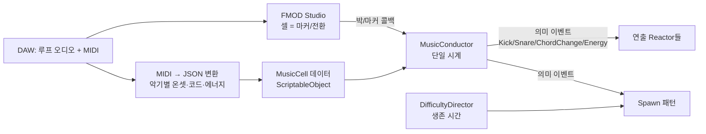

# Chord Pulse — FMOD 적응형 오디오 설계

> 목표: 플레이어가 디펜스를 하는 행위 자체가 곡을 "연주/편곡"하는 느낌이 들도록, 음악·적 등장·연출을 하나의 박자 기준 위에 올린다.

---

## 진행 현황

| 단계 | 상태 | 구현 위치 |
|---|---|---|
| 1. 박자 동기화 | ✅ 완료 (2026-11-24) | `Audio/MusicConductor.cs` — FMOD `TIMELINE_BEAT`/`TIMELINE_MARKER` 콜백으로 박을 직접 셈. `SoundManager`의 하드코딩 템포 표·타임라인 보정 제거. 난이도는 `ChordPulsePrototype.DifficultyLevel(생존 시간)`으로 분리 |
| 2. 반주·처치 화음 믹싱 | ✅ 완료 (2026-11-24) | FMOD `ChordPulseGame` 이벤트 내부 그룹 트랙 + `SoundManager.MusicMix / KillChordMix` |
| 3. 구간별 편곡·피버 | ✅ 완료 (2026-11-24) | 피버 빌드업·임팩트·아웃트로 트랙 + `Intensity` 파라미터로 일반 구간 밀도 조절 (`SoundManager.Intensity`, 현재는 난이도 단계와 연동) |
| 4. 랜덤 패턴·BPM | ⏳ | |
| 5. 음악 연동 시각 연출 | ⏳ | |

### 2단계 믹싱 구조 (FMOD 이벤트 내부)

```
Event Master  [Limiter ceiling -1 dB]
├─ Music Bed            ← MusicMix 파라미터(0~1)가 볼륨 자동화
│   ├─ Kick / Snare / Hats / Fever shaker / Bass / Fever bass fifths
│   └─ Harmony          [Compressor: 사이드체인 덕킹, thr -32 / 4:1 / 5ms / 180ms]
│       └─ Offbeat pluck / Fever lead (이후 패드도 여기)
└─ Kill Chords          ← KillChordMix 파라미터(0~1)가 볼륨 자동화
    [Sidechain → Harmony 덕킹 키] [Compressor thr -20 / 3:1] [Limiter -3 dB]
    └─ Red / Blue / Yellow kill chord
```

- 처치 화음은 음악 타임라인 위에 그대로 있어 박 정확도가 유지된다 (별도 이벤트로 분리하지 않음).
- 측정(108~116 BPM 구간, 이벤트 출력): 반주만 RMS -25.4 dBFS / 3색 × 3음 처치 화음 매 박 RMS -21.7 dBFS, 피크 -6.4 dBFS.
- 덕킹 양·컴프레서 수치는 귀로 최종 조정할 것 (FMOD Studio에서 그룹 트랙 이펙트 수정 후 빌드).

### 3단계 피버 진입 구조

```
QueueFever (8킬 달성)
   │  다음 마디 경계(룩어헤드 0.15초 이상 남은 마디)
   ▼
[빌드업 1마디]  FeverBuild=1   킥 빠짐 · 스네어 롤(8분→16분, -20→-4 dB, 피치 +4) · 플럭 아르페지오 상승(현재 마디 코드음, 2옥타브)
   ▼  마디 경계
[피버 4마디]    Fever=1        피버 리드 · 셰이커 · 베이스 5도 (기존)
                FeverImpact=1  첫 박만: 킥 + 클랩 + 오픈햇 임팩트
```

- 킥 트랙 볼륨 -7 → -12 dB (메인 드럼이 과하게 튀던 문제).
- 빌드업 악기는 32마디 전체 타임라인의 매 마디에 배치되고 `FeverBuild` 조건으로만 울린다 → 어느 마디에서 피버가 와도 동작.
- `SoundManager.FeverBuilding`으로 빌드업 마디를 알 수 있다 (HUD에 "FEVER INCOMING..." 표시, 5단계 시각 연출에서 활용).
- 피버 마지막 마디는 `FeverOutro=1`: 현재 코드음으로 2옥타브 하강하는 플럭 + 작아지며 내려가는 스네어 16분.

### 일반 구간 밀도 (`Intensity` 0~3)

| Intensity | 연주 악기 | 현재 연결 |
|---|---|---|
| 0 | 킥 · 스네어 · 클로즈드 햇 · 베이스 | 생존 0~17.8초 |
| 1 | + 오프비트 플럭 | 17.8초~ |
| 2 | + 오픈 햇 | 34.3초~ |
| 3 | + 스네어에 클랩 레이어 | 49.8초~, **피버 중에는 항상 3** |

- 현재는 `ChordPulsePrototype`이 난이도 단계를 그대로 넣는다. 4단계(랜덤 셀 선택)에서 셀의 `energy` 값이나 "숨 돌리는 구간"이 이 값을 직접 정하도록 바꾸면 된다.

## 0. 현재 구조 요약 (2026-11 기준, 작업 전)

| 항목 | 현재 구현 | 한계 |
|---|---|---|
| 박자 계산 | `SoundManager`의 `Tempos = {108,116,124,132}` 하드코딩 + `getTimelinePosition()`으로 초 → 스텝 역산 | FMOD 쪽 BPM/구간을 바꾸면 Unity 계산과 즉시 어긋남 |
| 루프 처리 | 마지막 구간에서 타임라인이 되감기면 `_timelineOffset`을 더하는 방식 | 구간이 랜덤하게 점프하면 "되감김"을 판별할 수 없음 |
| 피버 | `Fever` 파라미터 0/1, 다음 마디에 적용 | 진입 연출(필인/라이저) 없음 |
| 처치 화음 | 음악 이벤트 안의 `RedKills/BlueKills/YellowKills` 파라미터 | 반주와 같은 이벤트라 별도 믹싱·덕킹·음수 제한이 어려움 |
| 난이도 | `TempoStage`가 그룹 크기·반박 등장 확률을 결정 | 음악 변화(BPM)와 난이도가 한 몸이라 "숨 돌리는 구간"을 만들 수 없음 |

---

## 1. 박자·구간 정보를 FMOD 기준으로 통일

**원칙: 시계는 하나. FMOD가 "지금 몇 마디 몇 박인지"를 알려주고, Unity는 그것만 믿는다.**

- FMOD 이벤트 콜백 사용 ([문서](https://www.fmod.com/docs/2.02/api/studio-api-common.html#fmod_studio_event_callback_type))
  - `TIMELINE_BEAT` → `bar`, `beat`, `tempo`, `timesignatureupper/lower`, `position`
  - `TIMELINE_MARKER` → 마커 `name`, `position` (구간 ID 전달용)
  - 중첩 이벤트(Nested Event)로 루프를 구성할 경우 `TIMELINE_NESTED_TIMELINE_BEAT`(2.02+)도 고려
- 콜백은 **FMOD 스레드**에서 호출 → 스레드 안전 큐에 넣고 Unity 메인 스레드 `Update()`에서 꺼내 처리.
- Unity 측에 `MusicConductor`(단일 시계) 도입
  - 누적 마디 번호(`AbsoluteBar`)는 콜백의 `beat == 1` 횟수로 직접 센다 → 타임라인 되감기/점프와 무관.
  - 프레임 사이 연속값(`BeatPosition`)은 "마지막 박 콜백 시각 + 경과시간 × tempo/60"으로 보간.
  - 하드코딩 `Tempos` 표와 `_timelineOffset` 로직 제거.
- 출력 지연 보정값(`visualLatencyMs`)을 설정으로 두고 실측해서 맞춘다 (박 콜백은 믹싱 시점 기준이라 실제 귀에 들리는 시점보다 약간 빠를 수 있음).

```csharp
// 골격 예시 — 콜백은 FMOD 스레드에서 실행됨
[AOT.MonoPInvokeCallback(typeof(FMOD.Studio.EVENT_CALLBACK))]
static FMOD.RESULT OnMusicEvent(FMOD.Studio.EVENT_CALLBACK_TYPE type, IntPtr instancePtr, IntPtr paramPtr)
{
    var instance = new FMOD.Studio.EventInstance(instancePtr);
    instance.getUserData(out IntPtr data);
    var conductor = (MusicConductor)GCHandle.FromIntPtr(data).Target;

    if (type == FMOD.Studio.EVENT_CALLBACK_TYPE.TIMELINE_BEAT)
    {
        var beat = Marshal.PtrToStructure<FMOD.Studio.TIMELINE_BEAT_PROPERTIES>(paramPtr);
        conductor.Enqueue(MusicSignal.Beat(beat.bar, beat.beat, beat.tempo, beat.timesignatureupper));
    }
    else if (type == FMOD.Studio.EVENT_CALLBACK_TYPE.TIMELINE_MARKER)
    {
        var marker = Marshal.PtrToStructure<FMOD.Studio.TIMELINE_MARKER_PROPERTIES>(paramPtr);
        conductor.Enqueue(MusicSignal.Marker((string)marker.name, marker.position));
    }
    return FMOD.RESULT.OK;
}
// 등록: _handle = GCHandle.Alloc(this); _music.setUserData(GCHandle.ToIntPtr(_handle));
//       _music.setCallback(s_callback, TIMELINE_BEAT | TIMELINE_MARKER);  (delegate는 static 필드로 유지해 GC 방지)
```

**완료 기준**: FMOD Studio에서 BPM이나 구간 길이를 바꿔도 Unity 코드 수정 없이 적 등장·원 펄스가 박에 맞는다.

---

## 2. 랜덤 음악 = "구간(셀) 선택" 방식

- 처음부터 음을 생성하지 않고, **잘 맞는 조각(셀)을 미리 만들고 4~8마디마다 조합을 교체**한다.
- 레이어를 세로로 분리: `Drums × Bass × Melody (× Pad)` — 각 3~4종이면 12개 루프로 수십 가지 조합.
- **같은 코드 진행(예: C–Am–F–G) 안에서만 변주** → 어떤 조합이든 화성 충돌이 없고 곡의 일관성이 유지된다.
- 모든 셀은 4마디의 배수 길이, 같은 박자표.
- 전환은 FMOD Transition Region/Destination Marker를 **마디 단위로 퀀타이즈**.

## 3. 피버 = 곡의 하이라이트로 편곡

| | 일반 구간 | 피버 직전 (1마디) | 피버 |
|---|---|---|---|
| 드럼 | 기본 패턴 | 필인 / 스네어 롤 | 풀 킷 + 추가 타악기 |
| 베이스 | 단순 루트 | 정지 또는 슬라이드 | 옥타브/리듬 강화 |
| 멜로디 | 일부 비움 | 상승 라이저 | 리드 추가 |
| 패드 | 없음/약하게 | 필터 열림 | 풀 패드 |
| 처치 화음 | 유지 | 유지 | 유지 (한 옥타브 위/밝은 음색 가능) |

- `QueueFever()`가 "다음 마디"가 아니라 **"다음 다음 마디"**로 예약 → 그 사이 1마디를 필인/라이저 구간으로 사용.
- 피버 종료도 다운 필(필터 닫힘, 임팩트)로 명확히.

## 4. 처치 화음 믹싱 계획

- **반주와 처치 화음을 분리**: 처치 화음을 음악 이벤트의 파라미터가 아니라 별도 이벤트(또는 별도 트랙 → 별도 버스)로.
- 믹서 버스 구조
  ```
  Master
  ├─ Music
  │   ├─ Drums
  │   ├─ Bass
  │   └─ Harmony (Lead, Pad)   ← 사이드체인 덕킹 대상
  └─ KillChord                 ← 사이드체인 소스, 컴프레서 + 리미터
  ```
- 처치 화음이 울릴 때 `Harmony` 버스를 2~4dB 잠깐 낮춤 (FMOD 사이드체인 + 컴프레서, 빠른 어택/짧은 릴리즈).
- 많이 쌓일 때 대비
  - 이벤트 **Max Instances + Stealing**(가장 오래된/조용한 것 교체)
  - 같은 박에 겹친 처치는 지금처럼 박 단위로 모아 **보이싱 수만 늘림**(최대 3~4음), 볼륨은 √N 수준으로만 증가
  - KillChord 버스에 리미터
- 화음 음정은 **현재 코드(Chord)의 구성음**에서 고른다 → 섹션이 바뀌어도 항상 협화.

## 5. 음악 변화와 난이도 분리

```
spawnInterval = 음악 계수(BPM/에너지) × 난이도 계수(생존 시간)
```

- **음악 계수**: 셀의 BPM·에너지에 따라 등장 "박자 간격"을 결정 (느린 셀 = 숨 돌리는 구간).
- **난이도 계수**: 생존 시간에 따라 단조 증가 — 적 속도, 그룹 크기, 숨은 적 비율, 반박 등장 허용 여부.
- 현재 `TempoStage`가 그룹 크기·반박 확률을 정하는 부분을 `DifficultyLevel(생존시간)`로 교체.

## 추천 진행 순서

1. 박자 동기화 정리 (`MusicConductor`, 콜백, 하드코딩 템포 제거)
2. 반주·처치 화음 믹싱 (버스 분리, 덕킹, 음수 제한)
3. 구간별 편곡과 피버 (필인/라이저, 피버 전용 레이어)
4. 랜덤 패턴·BPM (셀 선택기)
5. 음악에 따른 시각 연출 (아래 6장)

---

## 6. 박자 기준으로 "수많은 루프 + 대응 연출"을 만든다면

루프가 수십~수백 개로 늘어날 때 **루프마다 연출을 손으로 짝지으면 반드시 무너진다.** 핵심은 _루프와 연출을 직접 연결하지 않고, 그 사이에 "음악 데이터" 층을 두는 것_이다.



### 6-1. 셀(Cell) 메타데이터를 표준화
각 루프에 같은 ID로 다음 데이터를 붙인다 (FMOD 마커 이름 = 셀 ID, Unity는 ID로 데이터 조회).

| 필드 | 예 | 용도 |
|---|---|---|
| `id` | `drum_break_02` | 마커 이름과 일치 |
| `role` | Drums / Bass / Melody / Pad / FX | 어느 연출 계층이 반응할지 |
| `bars` | 4, 8 | 전환 예약 |
| `bpm`, `timeSig` | 116, 4/4 | 검증용 (실제 값은 콜백 기준) |
| `energy` | 0~3 | 화면 강도, 등장 밀도 |
| `chords` | `[C, Am, F, G]` (마디별) | 처치 화음 음 선택, 색조 |
| `onsets` | 악기별 16분 스텝 목록 | 박 단위가 아닌 "실제로 친 음"에 연출 반응 |
| `tags` | `breath`, `buildup`, `drop` | 특수 연출/스폰 규칙 선택 |

- `onsets`와 `chords`는 **DAW에서 MIDI로 내보내 자동 변환**(에디터 스크립트)한다. 루프 100개여도 연출 코드는 0줄 추가.

### 6-2. 연출은 "루프"가 아니라 "역할·의미"에 반응
유한한 연출 어휘(Reactor)를 만들고 역할에 매핑한다.

| 음악 신호 | 연출 Reactor |
|---|---|
| Kick 온셋 | 코어 링 펄스, 카메라 미세 줌 (현재 `AnimateArena`) |
| Snare/Clap | 아레나 테두리 플래시 |
| Hi-hat | 배경 파티클 깜빡임 |
| 코드 변경 | 배경 색조 이동 (근음 → 색상) |
| Energy 변화 | 블룸/채도/파티클 양 |
| `buildup` 태그 | 화면 수축 + 라이저 연출, 피버 예고 |
| `drop`/피버 진입 | 화이트 플래시 + 링 확장 |

- 새 루프를 넣으면 메타데이터만으로 자동으로 연출이 따라온다.
- 꼭 필요한 시그니처 순간만 셀별 override 허용.

### 6-3. 랜덤 선택은 Unity가, 실행은 FMOD가
- FMOD 자체 랜덤(Multi Instrument)을 쓰면 **무엇이 나올지 Unity가 미리 모른다** → 적 등장 예고가 불가능.
- 권장: Unity의 `CellSelector`가 시드 기반으로 **다음 셀을 1~2마디 전에 결정** → FMOD 라벨 파라미터로 전달 → FMOD는 마디 경계에서 전환.
  - Unity가 미래를 알기 때문에 적을 "다음 구간 박에 맞춰" 미리 출발시킬 수 있다 (적이 도착하는 박 = 처치 화음이 울리는 박).
  - 시드 고정 → 버그 재현·리플레이·데일리 챌린지 가능.
- 게임플레이와 무관한 미세 변주(하이햇 변형, 필인 종류)만 FMOD 랜덤에 맡긴다.
- 선택 규칙 예: 같은 셀 연속 금지, 에너지는 ±1씩만 이동, 피버 전엔 `buildup` 강제, 일정 시간마다 `breath` 셀 보장.

### 6-4. BPM 변화 다루기
- BPM 단계는 2~3개로 제한, **단계마다 루프 세트를 따로 녹음** (타임스트레치보다 품질·박 정확도 우수).
- BPM 전환은 전용 전환 셀(필인)을 통해서만 → 듣는 사람도 템포 변화를 납득.
- Unity는 콜백의 `tempo`를 그대로 사용하므로 별도 처리 불필요.

### 6-5. 적 등장도 같은 데이터로
- 스폰 패턴 = "마디 단위 리듬 템플릿" 풀 (예: `X...X...X.X.....`)
- 셀의 `energy`/`tags` → 사용할 템플릿 풀, 난이도 → 템플릿 내 밀도·속도·숨은 적 비율.
- 선택적으로 **킥/스네어 온셋 위에 스폰**하면 "적을 잡으면 그 자리의 드럼이 연주되는" 느낌이 강해진다.

### 6-6. 제작 파이프라인과 검증
- 네이밍 규칙: `{role}_{name}_{bpm}_{bars}` (예: `bass_walk_116_8`)
- 에디터 검증 툴: FMOD 마커 이름 ↔ `MusicCell` 데이터 1:1 대응, 길이·BPM 불일치 경고. 런타임에 미등록 마커가 오면 경고 로그.
- 디버그 오버레이: 현재 마디/박, 현재 셀, 예약된 다음 셀, 박 콜백 대비 연출 오차(ms).
- 자동 플레이 봇으로 10분 이상 돌려 드리프트·박 누락 로그 확인.

### 6-7. 규모 가늠
- 레이어 4종 × 각 4셀 × BPM 2단계 = 루프 32개 → 조합 수백 가지.
- 이 정도면 1~2명의 사운드 작업량으로 충분하고, 연출 코드는 Reactor 7~10개로 고정된다.
