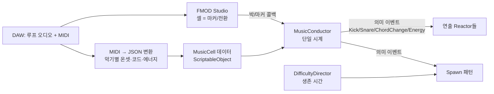

# Chord Pulse — FMOD 적응형 오디오 설계

> 목표: 플레이어가 디펜스를 하는 행위 자체가 곡을 "연주/편곡"하는 느낌이 들도록, 음악·적 등장·연출을 하나의 박자 기준 위에 올린다.

---

## 진행 현황

| 단계 | 상태 | 구현 위치 |
|---|---|---|
| 1. 박자 동기화 | ✅ 완료 (2026-11-24) | `Audio/MusicConductor.cs` — FMOD `TIMELINE_BEAT`/`TIMELINE_MARKER` 콜백으로 박을 직접 셈. `SoundManager`의 하드코딩 템포 표·타임라인 보정 제거. 난이도는 `ChordPulsePrototype.DifficultyLevel(생존 시간)`으로 분리 |
| 2. 반주·처치 화음 믹싱 | ✅ 완료 (2026-11-24) | FMOD `ChordPulseGame` 이벤트 내부 그룹 트랙 + `SoundManager.MusicMix / KillChordMix` |
| 3. 구간별 편곡·피버 | ✅ 완료 (2026-11-24) | 피버 빌드업·임팩트·아웃트로 트랙 + `Intensity` 파라미터로 일반 구간 밀도 조절 (`SoundManager.Intensity`, 현재는 난이도 단계와 연동) |
| 4. 랜덤 패턴·BPM | ✅ 1차 완료 (2026-11-24) | 4개 템포 구간을 4마디 프레이즈 단위로 점프 (FMOD 전환 마커 25개 + `NextSection`), `Audio/SectionSelector.cs`가 시드 기반으로 한 프레이즈 앞서 선택, 숨 돌리기 프레이즈 |
| 5. 음악 연동 시각 연출 | ✅ 1차 완료 (2026-11-24) | `Visual/MusicReactiveVisuals.cs` — 루프가 아닌 음악 의미(킥·스네어·코드·에너지·빌드업·피버·숨돌리기·구간 전환)에 반응 |
| 6. 랜덤 특색 루프 (기본 루프 위 레이어) | ✅ 1차 완료 (2026-11-24) — 트럼펫·휘파람 루프 6종 + 음표별 날아다니는 연출 (7-7 참고) | 트럼펫처럼 개성 있는 루프가 가끔 끼어들고, 루프마다 전용 화면 연출(무언가 날아다니는 등)이 함께 등장. 설계는 아래 [7장](#7-다음-단계-랜덤-특색-루프-feature-loop) |

### 2단계 믹싱 구조 (FMOD 이벤트 내부)

```
Event Master  [Limiter ceiling -1 dB]
├─ Music Bed            ← MusicMix 파라미터(0~1)가 볼륨 자동화
│   ├─ Kick / Snare / Hats / Fever shaker / Bass / Fever bass fifths
│   └─ Harmony          [Compressor: 사이드체인 덕킹, thr -32 / 4:1 / 5ms / 180ms — 2026-11-24 Task 6부터 return:/Harmony Duck, thr -20 / 2:1 / 5ms / 60ms]
│       └─ Offbeat pluck / Fever lead (이후 패드도 여기)
└─ Kill Chords          ← KillChordMix 파라미터(0~1)가 볼륨 자동화
    [Sidechain → Harmony 덕킹 키] [Compressor thr -20 / 3:1] [Limiter -3 dB]
    └─ Red / Blue / Yellow kill chord
```

- 처치 화음은 음악 타임라인 위에 그대로 있어 박 정확도가 유지된다 (별도 이벤트로 분리하지 않음).
- 측정(108~116 BPM 구간, 이벤트 출력): 반주만 RMS -25.4 dBFS / 3색 × 3음 처치 화음 매 박 RMS -21.7 dBFS, 피크 -6.4 dBFS.
- 덕킹 양·컴프레서 수치는 귀로 최종 조정할 것 (FMOD Studio에서 그룹 트랙 이펙트 수정 후 빌드).

### 3단계 피버 진입 구조

```
QueueFever (8킬 달성) → "FEVER READY"로 대기
   │  지금 프레이즈가 끝나는 경계에서 시작. 단, 아래면 한 프레이즈 더 기다림:
   │   · 빌드업 마디(프레이즈 4마디째) 시작까지 룩어헤드 0.15초가 안 남음
   │   · 지금 특색 루프가 4마디째에도 연주됨 (빌드업과 겹침)
   │  예약된 다음 특색 루프는 취소, 피버가 끝날 때까지 새 루프 선택 안 함
   ▼
[빌드업 1마디 = 프레이즈 4마디째]  FeverBuild=1   킥 빠짐 · 스네어 롤(8분→16분, -20→-4 dB, 피치 +4) · 플럭 아르페지오 상승(현재 마디 코드음, 2옥타브)
   ▼  마디 경계
[피버 4마디]    Fever=1        피버 리드 · 셰이커 · 베이스 5도 (기존)
                FeverImpact=1  첫 박만: 킥 + 클랩 + 오픈햇 임팩트
```

- **피버는 프레이즈에 정렬** (2026-11-24 변경): 예전에는 킬 수만 차면 바로 다음 마디에 빌드업이 시작돼 특색 루프나 프레이즈 중간에 끼어들었다. 이제 피버 4마디 = 프레이즈 하나 전체, 빌드업 = 그 앞 프레이즈의 마지막 마디. 테스트: 루프 없음·중간 충전 → 다음 경계(스텝 32), 브라스 솔로 연주 중 충전 → 한 프레이즈 뒤(160), 빌드업 마디 안에서 충전 → 한 프레이즈 뒤(288). 약 350스텝 동안 빌드업·피버 중 특색 루프가 울린 순간 0회.
- 킥 트랙 볼륨 -7 → -12 dB (메인 드럼이 과하게 튀던 문제).
- 빌드업 악기는 32마디 전체 타임라인의 매 마디에 배치되고 `FeverBuild` 조건으로만 울린다 → 어느 마디에서 피버가 와도 동작.
- `SoundManager.FeverBuilding`으로 빌드업 마디를 알 수 있다 (HUD에 "FEVER INCOMING..." 표시, 5단계 시각 연출에서 활용).
- 피버 마지막 마디는 `FeverOutro=1`: 현재 코드음으로 2옥타브 하강하는 플럭 + 작아지며 내려가는 스네어 16분.

### 일반 구간 밀도 (`Intensity` 0~3)

| Intensity | 연주 악기 | 현재 연결 |
|---|---|---|
| 0 | 킥 · 스네어 · 클로즈드 햇 · 베이스 | 생존 0~17.8초 |
| 1 | + 오프비트 플럭 | 17.8초~ |
| 2 | + 오픈 햇 | 34.3초~ |
| 3 | + 스네어에 클랩 레이어 | 49.8초~, **피버 중에는 항상 3** |

- 현재는 `ChordPulsePrototype`이 난이도 단계를 그대로 넣는다. 4단계(랜덤 셀 선택)에서 셀의 `energy` 값이나 "숨 돌리는 구간"이 이 값을 직접 정하도록 바꾸면 된다.

### 4단계 구간 선택 구조

```
[Unity] 프레이즈(4마디) 시작마다
   SectionSelector.Advance(목표 에너지=난이도, 피버 중엔 숨돌리기 금지)
     Current ← Next,  Next ← 새로 선택  ──setParameter("NextSection")──▶ [FMOD]
                                                                      프레이즈 경계(1ms 전) 전환 마커:
                                                                      NextSection == k 이면 Stage k 시작으로 점프
                                                                      (자연스러운 다음 구간이면 점프 없이 진행)
```

- 구간 = 기존 4개 템포 스테이지 (S0 108 · S1 116 · S2 124 · S3 132 BPM, 각 8마디 = 프레이즈 2개). 모든 구간이 같은 C–Am–F–G 진행이라 어디로 점프해도 화성이 이어진다.
- 선택 규칙: 목표 에너지 ±1 (25/50/25%), 같은 구간 3연속 금지.
- **피버 중 BPM 고정**: 빌드업 마디 시작 ~ 피버 끝 사이에 걸린 프레이즈 경계는 현재 구간을 유지한다 (`SoundManager.FeverHoldsBoundary`, `SectionSelector.HoldNext`). 다음 구간을 이미 FMOD에 보낸 뒤 피버가 예약되면 그 값을 현재 구간으로 덮어쓴다. 피버가 끝나는 경계부터 다시 자유 선택. 테스트: 다음 구간을 S3(132)로 강제한 뒤 피버 예약 → S1(116) 유지, 빌드업~피버 끝까지 116 BPM, 이후 S0로 이동 확인.
- **숨 돌리기 프레이즈**: 난이도 1 이상에서 22% 확률(최소 3프레이즈 간격, 연속 불가) → S0(108 BPM) + `Intensity` 0 + 적이 한 마리씩 한 마디 더 띄워 등장. HUD에 `~breathe~`. 난이도(적 속도·숨은 적)는 생존 시간 기준 그대로.
- Unity가 다음 프레이즈를 한 프레이즈(4마디) 앞서 알기 때문에 `SoundManager.UpcomingPhrase`, `NextPhraseStep`으로 적 등장·연출을 미리 준비할 수 있다.
- `SoundManager.sectionSeed` (Inspector): 0이면 매 판 랜덤, 값을 넣으면 같은 구간 순서 재현.
- `MusicConductor`는 점프 시 박 콜백이 중복·누락돼도 FMOD의 마디 내 박 번호에 맞춰 보정한다. 테스트(75초, 점프 6회)에서 프레이즈 시작 박이 16의 배수에서 어긋나지 않음.
- 알려진 사항: FMOD 경고 "Loading delay exceeded"가 Play 시작 직후 1회 나온다 (구간 점프가 없는 테스트에서도 발생 → 점프와 무관, 에디터 Play 진입 시 프레임 지연으로 추정). 빌드에서도 나오면 음악 시작 전 한 프레임 대기 등을 검토.

### 5단계 시각 연출 (`MusicReactiveVisuals`)

`ChordPulsePrototype`이 런타임에 `AddComponent`로 붙인다 (씬 수정 없음). 기존 `AnimateArena`는 이 컴포넌트로 옮겼다.

| 음악 신호 (`SoundManager`) | 연출 |
|---|---|
| `KickOn(beat)` — 빌드업 마디에선 false | 경계 링 펄스 + 카메라 1.2% 줌 펀치 |
| 스네어 박 (2·4박) | 경계 링 플래시 |
| `ChordIndex` (C·Am·F·G) | 배경 색조: 파랑 · 보라 · 청록 · 호박 |
| `ArrangementIntensity` | 배경 밝기 (편성이 두꺼울수록 진하게) |
| `FeverBuilding` | 마디 동안 아레나 6% 수축 + 스네어 롤에 맞춘 깜빡임 (8분→16분), 금색 |
| `FeverActive` 진입 | 흰 플래시 + 바깥으로 퍼지는 링, 피버 동안 카메라 2.5% 줌아웃, 킥 펄스 흰색 |
| `IsBreath` | 배경 탈채도·어둡게, 킥 펄스 절반 |
| `FeverActive` 종료 | 차가운 파란색(킥 색) 리플 링 → 평상시로 복귀 |
| ~~`SectionIndex` 변경 (템포 점프)~~ | 리플 제거 (2026-11-24). 특색 루프 등장과 같은 박에 겹치고, 플레이어 펄스와 모양이 같아 헷갈림. 리플은 피버 시작·끝에만 |

- Play 테스트 확인: 코드별 배경 변화, 빌드업 마디 스텝 16~23 동안 수축 0.985→0.947, 피버 첫 박 배경 플래시·리플·흰 킥 펄스.
- 새 음악 셀을 추가해도 위 신호만 제공되면 연출 코드는 바꿀 필요가 없다 (6-2 설계).

## 0. 현재 구조 요약 (2026-11 기준, 작업 전)

| 항목 | 현재 구현 | 한계 |
|---|---|---|
| 박자 계산 | `SoundManager`의 `Tempos = {108,116,124,132}` 하드코딩 + `getTimelinePosition()`으로 초 → 스텝 역산 | FMOD 쪽 BPM/구간을 바꾸면 Unity 계산과 즉시 어긋남 |
| 루프 처리 | 마지막 구간에서 타임라인이 되감기면 `_timelineOffset`을 더하는 방식 | 구간이 랜덤하게 점프하면 "되감김"을 판별할 수 없음 |
| 피버 | `Fever` 파라미터 0/1, 다음 마디에 적용 | 진입 연출(필인/라이저) 없음 |
| 처치 화음 | 음악 이벤트 안의 `RedKills/BlueKills/YellowKills` 파라미터 | 반주와 같은 이벤트라 별도 믹싱·덕킹·음수 제한이 어려움 |
| 난이도 | `TempoStage`가 그룹 크기·반박 등장 확률을 결정 | 음악 변화(BPM)와 난이도가 한 몸이라 "숨 돌리는 구간"을 만들 수 없음 |

---

## 1. 박자·구간 정보를 FMOD 기준으로 통일

**원칙: 시계는 하나. FMOD가 "지금 몇 마디 몇 박인지"를 알려주고, Unity는 그것만 믿는다.**

- FMOD 이벤트 콜백 사용 ([문서](https://www.fmod.com/docs/2.02/api/studio-api-common.html#fmod_studio_event_callback_type))
  - `TIMELINE_BEAT` → `bar`, `beat`, `tempo`, `timesignatureupper/lower`, `position`
  - `TIMELINE_MARKER` → 마커 `name`, `position` (구간 ID 전달용)
  - 중첩 이벤트(Nested Event)로 루프를 구성할 경우 `TIMELINE_NESTED_TIMELINE_BEAT`(2.02+)도 고려
- 콜백은 **FMOD 스레드**에서 호출 → 스레드 안전 큐에 넣고 Unity 메인 스레드 `Update()`에서 꺼내 처리.
- Unity 측에 `MusicConductor`(단일 시계) 도입
  - 누적 마디 번호(`AbsoluteBar`)는 콜백의 `beat == 1` 횟수로 직접 센다 → 타임라인 되감기/점프와 무관.
  - 프레임 사이 연속값(`BeatPosition`)은 "마지막 박 콜백 시각 + 경과시간 × tempo/60"으로 보간.
  - 하드코딩 `Tempos` 표와 `_timelineOffset` 로직 제거.
- 출력 지연 보정값(`visualLatencyMs`)을 설정으로 두고 실측해서 맞춘다 (박 콜백은 믹싱 시점 기준이라 실제 귀에 들리는 시점보다 약간 빠를 수 있음).

```csharp
// 골격 예시 — 콜백은 FMOD 스레드에서 실행됨
[AOT.MonoPInvokeCallback(typeof(FMOD.Studio.EVENT_CALLBACK))]
static FMOD.RESULT OnMusicEvent(FMOD.Studio.EVENT_CALLBACK_TYPE type, IntPtr instancePtr, IntPtr paramPtr)
{
    var instance = new FMOD.Studio.EventInstance(instancePtr);
    instance.getUserData(out IntPtr data);
    var conductor = (MusicConductor)GCHandle.FromIntPtr(data).Target;

    if (type == FMOD.Studio.EVENT_CALLBACK_TYPE.TIMELINE_BEAT)
    {
        var beat = Marshal.PtrToStructure<FMOD.Studio.TIMELINE_BEAT_PROPERTIES>(paramPtr);
        conductor.Enqueue(MusicSignal.Beat(beat.bar, beat.beat, beat.tempo, beat.timesignatureupper));
    }
    else if (type == FMOD.Studio.EVENT_CALLBACK_TYPE.TIMELINE_MARKER)
    {
        var marker = Marshal.PtrToStructure<FMOD.Studio.TIMELINE_MARKER_PROPERTIES>(paramPtr);
        conductor.Enqueue(MusicSignal.Marker((string)marker.name, marker.position));
    }
    return FMOD.RESULT.OK;
}
// 등록: _handle = GCHandle.Alloc(this); _music.setUserData(GCHandle.ToIntPtr(_handle));
//       _music.setCallback(s_callback, TIMELINE_BEAT | TIMELINE_MARKER);  (delegate는 static 필드로 유지해 GC 방지)
```

**완료 기준**: FMOD Studio에서 BPM이나 구간 길이를 바꿔도 Unity 코드 수정 없이 적 등장·원 펄스가 박에 맞는다.

---

## 2. 랜덤 음악 = "구간(셀) 선택" 방식

- 처음부터 음을 생성하지 않고, **잘 맞는 조각(셀)을 미리 만들고 4~8마디마다 조합을 교체**한다.
- 레이어를 세로로 분리: `Drums × Bass × Melody (× Pad)` — 각 3~4종이면 12개 루프로 수십 가지 조합.
- **같은 코드 진행(예: C–Am–F–G) 안에서만 변주** → 어떤 조합이든 화성 충돌이 없고 곡의 일관성이 유지된다.
- 모든 셀은 4마디의 배수 길이, 같은 박자표.
- 전환은 FMOD Transition Region/Destination Marker를 **마디 단위로 퀀타이즈**.

## 3. 피버 = 곡의 하이라이트로 편곡

| | 일반 구간 | 피버 직전 (1마디) | 피버 |
|---|---|---|---|
| 드럼 | 기본 패턴 | 필인 / 스네어 롤 | 풀 킷 + 추가 타악기 |
| 베이스 | 단순 루트 | 정지 또는 슬라이드 | 옥타브/리듬 강화 |
| 멜로디 | 일부 비움 | 상승 라이저 | 리드 추가 |
| 패드 | 없음/약하게 | 필터 열림 | 풀 패드 |
| 처치 화음 | 유지 | 유지 | 유지 (한 옥타브 위/밝은 음색 가능) |

- `QueueFever()`가 "다음 마디"가 아니라 **"다음 다음 마디"**로 예약 → 그 사이 1마디를 필인/라이저 구간으로 사용.
- 피버 종료도 다운 필(필터 닫힘, 임팩트)로 명확히.

## 4. 처치 화음 믹싱 계획

- **반주와 처치 화음을 분리**: 처치 화음을 음악 이벤트의 파라미터가 아니라 별도 이벤트(또는 별도 트랙 → 별도 버스)로.
- 믹서 버스 구조
  ```
  Master
  ├─ Music
  │   ├─ Drums
  │   ├─ Bass
  │   └─ Harmony (Lead, Pad)   ← 사이드체인 덕킹 대상
  └─ KillChord                 ← 사이드체인 소스, 컴프레서 + 리미터
  ```
- 처치 화음이 울릴 때 `Harmony` 버스를 2~4dB 잠깐 낮춤 (FMOD 사이드체인 + 컴프레서, 빠른 어택/짧은 릴리즈).
- 많이 쌓일 때 대비
  - 이벤트 **Max Instances + Stealing**(가장 오래된/조용한 것 교체)
  - 같은 박에 겹친 처치는 지금처럼 박 단위로 모아 **보이싱 수만 늘림**(최대 3~4음), 볼륨은 √N 수준으로만 증가
  - KillChord 버스에 리미터
- **펄스 1회 = 처치 화음 1회** (2026-11-24 구현)
  - 펄스 속도를 박 기준으로: 코어 → 아레나 끝까지 항상 **0.75박** (`ChordPulsePrototype.PulseBeats`, `SoundManager.BeatSeconds`). 예전 고정 5 유닛/초는 108 BPM에서 약 1.5박, 132 BPM에서 약 1.85박이 걸려 가까운 적과 먼 적이 서로 다른 박에 화음을 냈다.
  - 펄스의 첫 처치가 화음 박을 정하고, 같은 펄스의 이후 처치는 그 박의 화음에 보이싱으로 합류 (`QueueKillChord(color, chordStep)`). 그 박이 이미 울렸으면 소리 없이 파편 연출만.
  - 테스트(116 BPM, 가까운 적 1.3 + 아레나 끝 적 4.55, 3회): 끝 도달 0.68~0.88박, 처치 화음 각 1회.
  - 다음 후보: 박 근처 입력에 보너스("퍼펙트 펄스", 보이싱 +1), 다중 처치를 같은 박 안의 16분 아르페지오로(스트럼), 펄스 입력 8분음표 양자화, 박당 펄스 1회 제한.
- 화음 음정은 **현재 코드(Chord)의 구성음**에서 고른다 → 섹션이 바뀌어도 항상 협화.

## 5. 음악 변화와 난이도 분리

```
spawnInterval = 음악 계수(BPM/에너지) × 난이도 계수(생존 시간)
```

- **음악 계수**: 셀의 BPM·에너지에 따라 등장 "박자 간격"을 결정 (느린 셀 = 숨 돌리는 구간).
- **난이도 계수**: 생존 시간에 따라 단조 증가 — 적 속도, 그룹 크기, 숨은 적 비율, 반박 등장 허용 여부.
- 현재 `TempoStage`가 그룹 크기·반박 확률을 정하는 부분을 `DifficultyLevel(생존시간)`로 교체.

## 추천 진행 순서

1. 박자 동기화 정리 (`MusicConductor`, 콜백, 하드코딩 템포 제거)
2. 반주·처치 화음 믹싱 (버스 분리, 덕킹, 음수 제한)
3. 구간별 편곡과 피버 (필인/라이저, 피버 전용 레이어)
4. 랜덤 패턴·BPM (셀 선택기)
5. 음악에 따른 시각 연출 (아래 6장)

---

## 6. 박자 기준으로 "수많은 루프 + 대응 연출"을 만든다면

루프가 수십~수백 개로 늘어날 때 **루프마다 연출을 손으로 짝지으면 반드시 무너진다.** 핵심은 _루프와 연출을 직접 연결하지 않고, 그 사이에 "음악 데이터" 층을 두는 것_이다.



### 6-1. 셀(Cell) 메타데이터를 표준화
각 루프에 같은 ID로 다음 데이터를 붙인다 (FMOD 마커 이름 = 셀 ID, Unity는 ID로 데이터 조회).

| 필드 | 예 | 용도 |
|---|---|---|
| `id` | `drum_break_02` | 마커 이름과 일치 |
| `role` | Drums / Bass / Melody / Pad / FX | 어느 연출 계층이 반응할지 |
| `bars` | 4, 8 | 전환 예약 |
| `bpm`, `timeSig` | 116, 4/4 | 검증용 (실제 값은 콜백 기준) |
| `energy` | 0~3 | 화면 강도, 등장 밀도 |
| `chords` | `[C, Am, F, G]` (마디별) | 처치 화음 음 선택, 색조 |
| `onsets` | 악기별 16분 스텝 목록 | 박 단위가 아닌 "실제로 친 음"에 연출 반응 |
| `tags` | `breath`, `buildup`, `drop` | 특수 연출/스폰 규칙 선택 |

- `onsets`와 `chords`는 **DAW에서 MIDI로 내보내 자동 변환**(에디터 스크립트)한다. 루프 100개여도 연출 코드는 0줄 추가.

### 6-2. 연출은 "루프"가 아니라 "역할·의미"에 반응
유한한 연출 어휘(Reactor)를 만들고 역할에 매핑한다.

| 음악 신호 | 연출 Reactor |
|---|---|
| Kick 온셋 | 코어 링 펄스, 카메라 미세 줌 (현재 `AnimateArena`) |
| Snare/Clap | 아레나 테두리 플래시 |
| Hi-hat | 배경 파티클 깜빡임 |
| 코드 변경 | 배경 색조 이동 (근음 → 색상) |
| Energy 변화 | 블룸/채도/파티클 양 |
| `buildup` 태그 | 화면 수축 + 라이저 연출, 피버 예고 |
| `drop`/피버 진입 | 화이트 플래시 + 링 확장 |

- 새 루프를 넣으면 메타데이터만으로 자동으로 연출이 따라온다.
- 꼭 필요한 시그니처 순간만 셀별 override 허용.

### 6-3. 랜덤 선택은 Unity가, 실행은 FMOD가
- FMOD 자체 랜덤(Multi Instrument)을 쓰면 **무엇이 나올지 Unity가 미리 모른다** → 적 등장 예고가 불가능.
- 권장: Unity의 `CellSelector`가 시드 기반으로 **다음 셀을 1~2마디 전에 결정** → FMOD 라벨 파라미터로 전달 → FMOD는 마디 경계에서 전환.
  - Unity가 미래를 알기 때문에 적을 "다음 구간 박에 맞춰" 미리 출발시킬 수 있다 (적이 도착하는 박 = 처치 화음이 울리는 박).
  - 시드 고정 → 버그 재현·리플레이·데일리 챌린지 가능.
- 게임플레이와 무관한 미세 변주(하이햇 변형, 필인 종류)만 FMOD 랜덤에 맡긴다.
- 선택 규칙 예: 같은 셀 연속 금지, 에너지는 ±1씩만 이동, 피버 전엔 `buildup` 강제, 일정 시간마다 `breath` 셀 보장.

### 6-4. BPM 변화 다루기
- BPM 단계는 2~3개로 제한, **단계마다 루프 세트를 따로 녹음** (타임스트레치보다 품질·박 정확도 우수).
- BPM 전환은 전용 전환 셀(필인)을 통해서만 → 듣는 사람도 템포 변화를 납득.
- Unity는 콜백의 `tempo`를 그대로 사용하므로 별도 처리 불필요.

### 6-5. 적 등장도 같은 데이터로
- 스폰 패턴 = "마디 단위 리듬 템플릿" 풀 (예: `X...X...X.X.....`)
- 셀의 `energy`/`tags` → 사용할 템플릿 풀, 난이도 → 템플릿 내 밀도·속도·숨은 적 비율.
- 선택적으로 **킥/스네어 온셋 위에 스폰**하면 "적을 잡으면 그 자리의 드럼이 연주되는" 느낌이 강해진다.

### 6-6. 제작 파이프라인과 검증
- 네이밍 규칙: `{role}_{name}_{bpm}_{bars}` (예: `bass_walk_116_8`)
- 에디터 검증 툴: FMOD 마커 이름 ↔ `MusicCell` 데이터 1:1 대응, 길이·BPM 불일치 경고. 런타임에 미등록 마커가 오면 경고 로그.
- 디버그 오버레이: 현재 마디/박, 현재 셀, 예약된 다음 셀, 박 콜백 대비 연출 오차(ms).
- 자동 플레이 봇으로 10분 이상 돌려 드리프트·박 누락 로그 확인.

### 6-7. 규모 가늠
- 레이어 4종 × 각 4셀 × BPM 2단계 = 루프 32개 → 조합 수백 가지.
- 이 정도면 1~2명의 사운드 작업량으로 충분하고, 연출 코드는 Reactor 7~10개로 고정된다.

---

## 7. 다음 단계: 랜덤 특색 루프 (Feature Loop)

> 기본 루프(드럼·베이스·하모니, 1~5단계에서 만든 반주)는 그대로 깔아 두고, 그 **위에** 개성 있는 루프가 랜덤하게 끼어든다. 예: 트럼펫 팡파레, 신스 브라스 훅, 휘파람 멜로디, 보컬 찹, 라틴 퍼커션 등.
> 특색 루프는 **소리와 화면 연출이 한 세트**다. 트럼펫이 끼어들면 화면에 무언가가 갑자기 날아다니는 식으로, "곡에 손님이 등장했다"는 느낌을 준다.

### 7-1. 기본 루프와의 관계

| | 기본 루프 | 특색 루프 |
|---|---|---|
| 역할 | 곡의 뼈대, 항상 재생 | 가끔 끼어드는 이벤트성 레이어 |
| 선택 | 구간(`SectionSelector`) | 별도 `FeatureSelector`가 기본 구간 위에 얹음 |
| 길이 | 4마디 프레이즈 | 1~4마디 (프레이즈 경계에서 시작) |
| 연출 | 의미 기반 공통 연출 (6-2) | **루프별 전용 연출** (6-2의 "시그니처 override"에 해당) |
| 화성 | C–Am–F–G | 같은 진행 위에서만 작곡 → 어느 구간에 얹어도 협화 |

### 7-2. 오디오 구조 (FMOD)

- `ChordPulseGame` 이벤트에 `Feature` 그룹 트랙 추가 → `Music Bed`와 별도로 둔다.
  - 특색 루프는 `FeatureLoop` 파라미터(라벨형: 0 = 없음, 1 = Trumpet, 2 = …)를 조건으로 프레이즈 시작 지점마다 배치 (피버 빌드업 트랙과 같은 방식).
  - 템포 구간이 4개이므로 루프마다 구간별 BPM 버전이 필요하다 (또는 짧은 원샷 프레이즈로 만들어 구간마다 배치).
- 믹싱
  - 특색 루프가 들어오면 `Harmony`(플럭·리드)를 사이드체인으로 살짝 덕킹 → 주인공 자리를 비켜준다 (2단계 Kill Chords 덕킹과 같은 구조).
  - 처치 화음은 여전히 최우선: `Kill Chords` 사이드체인이 `Feature`도 덕킹하도록 연결.
  - `Feature` 그룹에 리미터, 볼륨은 `FeatureMix` 파라미터로 Unity에서 조절 (2단계 `MusicMix`와 동일).

### 7-3. 선택 규칙 (Unity `FeatureSelector`)

- 4단계와 같이 **한 프레이즈 앞서** 결정 → `SoundManager.UpcomingPhrase`처럼 `UpcomingFeature`를 노출해 연출·스폰이 미리 준비.
- 시드 기반 (`sectionSeed`와 같은 시드 사용 → 리플레이 재현).
- 빈도: 기본은 낮게 (예: 프레이즈당 15~25%), 같은 루프 연속 금지, 최근 N회 등장한 루프는 가중치 감소.
- 상황별 규칙
  - 숨 돌리기 프레이즈: 잔잔한 특색 루프만 허용 (예: 휘파람) → 쉬는 구간이 지루하지 않게.
  - 피버 빌드업·피버 중: 끼어들지 않음 (피버가 하이라이트) 또는 피버 전용 특색 루프만.
  - 난이도가 높을수록 화려한 루프(브라스, 퍼커션) 가중치 증가.

### 7-4. 화면 연출 (루프 = 연출 세트)

- 루프마다 데이터 한 세트: `FeatureLoopData` (ScriptableObject)
  - `id`, FMOD 라벨 값, 길이(마디), 분위기 태그(`calm` / `hype` / `fever`)
  - **연출 프리팹** + 등장 타이밍 (프레이즈 시작, 특정 박, 멜로디 온셋)
  - 온셋 데이터 (6-1처럼 MIDI에서 추출) → 트럼펫 음 하나하나에 맞춰 연출이 반응
- 연출 예시

| 특색 루프 | 화면 연출 |
|---|---|
| 트럼펫 팡파레 | 아레나 밖에서 반짝이는 오브젝트(별·새·종이비행기)가 음표마다 휙 가로질러 날아감 |
| 신스 브라스 훅 | 배경에 큰 원형 파동이 음 높이에 맞춰 퍼짐 |
| 휘파람 (숨 돌리기용) | 느리게 떠다니는 빛 입자, 배경 살짝 밝아짐 |
| 라틴 퍼커션 | 아레나 테두리를 따라 작은 점들이 리듬에 맞춰 회전 |

- 원칙
  - **게임플레이 가독성 우선**: 날아다니는 오브젝트는 아레나 바깥·배경 레이어에서, 적과 헷갈리지 않는 형태·색으로.
  - 등장 1박 전에 예고(작은 반짝임)를 주면 "끼어든다"는 느낌이 살아난다 → 한 프레이즈 앞서 알고 있으므로 가능.
  - 공통 연출(`MusicReactiveVisuals`)과 겹칠 때는 특색 연출이 위, 공통 연출은 약하게.

### 7-5. 게임플레이 연결 (선택)

- 특색 루프 동안만 나오는 보너스 적/오브젝트 (예: 날아다니는 트럼펫 별을 맞히면 피버 게이지 +1).
- 특색 루프 음표 박에 처치하면 처치 화음이 그 루프 음색으로 바뀌는 등 "같이 연주한다"는 보상.
- 단, 난이도 곡선은 5장 원칙대로 생존 시간 기준 유지 — 특색 루프는 보상·분위기 담당.

### 7-6. 진행 순서 제안

1. 트럼펫 루프 1개로 수직 슬라이스: FMOD `Feature` 트랙 + `FeatureLoop` 파라미터 + Unity 선택(한 프레이즈 앞) + 날아다니는 연출 1종.
2. 믹싱(덕킹·리미터·`FeatureMix`) 조정 후 귀로 검증.
3. `FeatureLoopData` 구조로 일반화 → 루프 2~3개 추가 (calm 1개 포함).
4. (선택) 보너스 오브젝트 등 게임플레이 연결.

### 7-7. 1차 구현 현황 (2026-11-24)

- **오디오**: `FMOD/Tools/feature_loops.py`가 루프 6종(트럼펫 팡파레·트럼펫 상승·휘파람 훅·휘파람 스킵·브라스 솔로·콜 앤 리스폰스)을 4개 템포 구간의 모든 프레이즈 시작에 배치하는 `feature_loops.js`를 만든다. `Feature` 버스는 처치 화음에 덕킹되고 하모니를 덕킹한다. 샘플은 VSCO 2 CE(CC0) 트럼펫·플루트, 출처는 `sample-manifest.json`·`SOURCES_AND_LICENSES.txt`.
- **선택**: `Audio/FeatureSelector.cs` — 한 프레이즈 앞서 결정, 약 32% 확률, 연속 금지, 첫 두 프레이즈·숨 돌리기·피버(빌드업 포함)에는 없음.
- **연출**: `Visual/FeatureLoopVisuals.cs` (프로토타입이 런타임에 붙임)
  - 음표 타이밍은 같은 파이썬 스크립트가 생성하는 `Audio/FeatureLoopNotes.g.cs`에서 읽는다 → 루프를 고치고 스크립트를 다시 돌리면 FMOD 음표와 연출이 함께 바뀐다. **`.g.cs`는 직접 고치지 말 것.**
  - 트럼펫 음 → 화면을 가로지르는 금색 혜성 (음이 높을수록 위, 화음 스탭은 여러 개로 갈라짐)
  - 휘파람 음 → 아레나 옆 공간에서 날갯짓하며 올라가는 새
  - 루프 시작 1박 전 → 화면 양쪽 가장자리 반짝임 (예고)
  - 모두 아레나 뒤(정렬 순서 -3), 반투명 → 적과 헷갈리지 않게
- **테스트**: 다음 프레이즈 루프를 브라스 솔로로 강제 → 스텝 31에 `FeatureLoop=5` 전송·예고 반짝임 6개, 스텝 32부터 재생·동시 비행체 최대 7개. 콜 앤 리스폰스 2마디째(휘파람)에서 아레나 양옆 새 확인 (스크린샷).
- 남은 것: 귀로 듣고 루프 음량·덕킹 조정, 혜성·새 크기와 투명도 조정, 7-5 게임플레이 연결.

### 7-8. 특색 루프 2차 (2026-11-24)

새로 들어온 샘플로 루프 6개를 추가했다 (총 12개, `FeatureLoop` 0~12).

| ID | 이름 | 위치 | 악기 (FMOD 트랙) |
|---|---|---|---|
| 7 | Latin Groove | 4마디 | 카우벨·3-2 클라베·아고고·콩가·귀로, 마지막 마디 봉고/콩가 필 (`Feature perc`) |
| 8 | Marimba Run | 3~4마디 (F, G) | 마림바 16분 아르페지오 + 실로폰 강세 (`Feature mallets`) |
| 9 | Glock Sparkle | 2마디 (Am) | 글로켄슈필 상승 아르페지오 |
| 10 | Synth Hook | 4마디 | AT20V ScreamLead 리프, 게이트 처리 (`Feature synth`, 로우패스 6.5k) |
| 11 | Power Chord Hits | 4마디 (G) | Thrum 파워코드 G5 싱코페이션 (`Feature guitar`) |
| 12 | Mallet Hook | 1~2마디 (C, Am) | 실로폰 멜로디 + 뮤트 카우벨 |

- 오프라인 렌더 검증: 음높이 (말렛은 비정수 배음이 커서 스펙트럼 피크로 기음 확인), 파워코드 G2-D3-G3, 루프 RMS가 반주보다 약 3~5 dB 아래.
- `FeatureLoopNotes.Note.Instrument`로 악기 구분 가능 (기존 `Whistle` 필드는 그대로). 새 악기 전용 화면 연출은 아직 없음 → 현재는 휘파람이 아닌 음이 모두 혜성으로 나온다.
- LaLaLead(보컬) 샘플은 기준 음높이 측정이 불확실해 보류.

## 8. 다음 단계: 적응형 배경 루프 (Adaptive Bed)

> 특색 루프가 "가끔 오는 손님"이라면, 배경 루프는 **게임 상태를 계속 반영하는 바탕**이다. 네 축을 모두 만들되, 서로 다른 시간 단위로 움직이게 해서 겹쳐도 어지럽지 않게 한다.

| 축 | 파라미터 | 바뀌는 단위 | 입력 (Unity) |
|---|---|---|---|
| 8-1 위기감 | `Tension` 0~1 (연속, seek speed로 부드럽게) | 즉시 (수백 ms) | 가장 가까운 적의 거리, 남은 체력 |
| 8-2 콤보 | `Combo` 0~3, 피격 시 `Hurt` 펄스 | 박/마디 | 연속 처치 수, 피격 |
| 8-3 패턴 변형 | `Variation` 0~2 | 프레이즈 (4마디) | 시드 기반 선택, 한 프레이즈 앞서 |
| 8-4 스타일 | `BedStyle` 0~3 | 2~4 프레이즈 | 스타일 선택기, 숨 돌리기·피버 규칙 |

### 8-1. 위기감 반응 레이어 (`Tension`)
- 계산: `max(근접도, 체력 위기)`. 근접도 = 가장 가까운 적이 아레나 반지름의 몇 % 안쪽인지, 체력 위기 = 체력 1이면 0.8 이상.
- 레이어 (구간·스타일과 무관하게 같은 C–Am–F–G 위)
  - 0.3~: 긴장 패드 (AT700_EnsembleStrings / ATFS1_WhisperPad, 마디당 코드 1개, 볼륨이 Tension에 비례)
  - 0.5~: 서브 펄스 (DeviceNTI_SineSub 8분, 사이드체인처럼 킥에 맞춰 숨쉼)
  - 0.7~: 베이스를 애시드 베이스(AT303_Squelch)로 교체 — 기존 베이스 트랙과 크로스페이드
  - 체력 1: `Music Bed`에 로우패스 자동화(18k → 2.5k)와 하이햇 볼륨 감소 → "숨막힘". 특색 루프·처치 화음은 필터 밖에 있어 또렷하게 남는다.
- 피버 중에는 Tension 0으로 고정 (피버는 해방감).

### 8-2. 콤보 반응
- `Combo`: 연속 처치 0~3단계 (예: 0 / 4 / 8 / 12킬). 피격 시 0으로.
  - 1: 하이햇 16분 레이어, 2: 화성 패드(글래스 패드) 추가, 3: 베이스 옥타브 점프 패턴.
  - 단계는 **다음 마디 경계**에서만 반영 (Unity가 룩어헤드로 전송) → 박이 흔들리지 않게.
- `Hurt`: 피격 순간 1 → 0.6초에 걸쳐 0으로. Music Bed 로우패스·볼륨 살짝 다운 (덕킹 느낌).
- 피버 게이지(8킬)와 겹치므로, 콤보 3단계 ≈ "피버 직전 고조"로 들리게 맞춘다.

### 8-3. 패턴 변형 (반복 줄이기)
- 베이스·플럭·드럼에 각각 A/B/C 3가지 4마디 패턴. `Variation`(프레이즈마다 0~2)로 고르되 악기별로 조합이 다르게 매핑 (예: Variation 1 = 베이스 B + 드럼 A + 플럭 C).
- 드럼 C는 4마디째에 필인 → 프레이즈 경계가 귀로도 들리게.
- `SectionSelector`와 같은 방식으로 한 프레이즈 앞서 결정, 같은 시드로 재현.

### 8-4. 스타일 전환 (`BedStyle`)
| 값 | 스타일 | 드럼 | 베이스 | 화성 | 쓰임 |
|---|---|---|---|---|---|
| 0 | 신스팝 (현재) | Pallor 킥/스네어/햇 | AT101V 베이스 | 오프비트 플럭 | 기본, 피버는 항상 0 |
| 1 | 라틴 | 킥 + 콩가/봉고/셰이커 | 툼바오 리듬 베이스 | 마림바 몬투노 | 중간 에너지 |
| 2 | 펑크 | 킥/스네어 + 16분 햇 | AT303 RubberRoot 슬랩 | 클린 기타 커팅 + FM 키 | 높은 에너지 |
| 3 | 드리미 | 림/셰이커만 | 서브 베이스 | 글래스 패드·코러스·벨 | 숨 돌리기 전용 |
- 선택: 2~4프레이즈 유지 후 전환 (너무 자주 바뀌면 산만), 숨 돌리기 프레이즈는 항상 3, 피버는 항상 0.
- 전환 직전 마디에 짧은 필/리버스 심벌 대신 드럼 필 → 자연스러운 이음.
- 특색 루프와의 관계: 라틴 스타일 중에는 Latin Groove를 고르지 않는 식으로 `FeatureSelector`에 스타일별 제외 목록.
- 화면: 스타일별 배경 팔레트를 `MusicReactiveVisuals`에 추가 (신스팝 네온 / 라틴 따뜻한 색 / 펑크 보라·주황 / 드리미 파스텔).

### 8-5. 구현 순서 제안
1. **8-1 위기감** — 게임 상태가 바로 들리는 효과가 가장 크고, 새 트랙 몇 개 + Unity 계산 하나로 끝난다.
2. **8-3 패턴 변형** — 기존 트랙에 패턴만 추가, 반복감이 바로 줄어든다.
3. **8-2 콤보** — 8-1과 같은 "레이어 + 파라미터" 구조 재사용.
4. **8-4 스타일** — 스타일마다 드럼·베이스·화성 전체가 필요해 가장 크다. 라틴 1개로 먼저 검증 후 확장.
- 모든 단계는 특색 루프와 같은 방식: `FMOD/Tools/`의 파이썬 생성기 → `fmodstudiocl -script` → 오프라인 렌더로 음높이·레벨·타이밍 검증 → Unity 연결.

### 8-6. 8-1 위기감 레이어 구현 현황 (2026-11-24)

- 생성기: `FMOD/Tools/bed_tension.py` → `bed_tension.js` (재실행 시 이전 결과를 지우고 다시 만든다).
- FMOD 파라미터 (둘 다 0~1, seek speed로 FMOD가 부드럽게 따라감: 오를 때 빠르게, 내릴 때 천천히)
  - `Tension`: 2.0/s 상승, 0.5/s 하강
  - `Danger`: 3.0/s 상승, 1.0/s 하강
- 트랙 (모두 `Music Bed` 안 → `MusicMix`에 같이 반응, 32마디 전체 = 4개 템포 구간에 배치)

| 트랙 | 샘플 | 내용 | Tension 볼륨 곡선 |
|---|---|---|---|
| Tension strings | AT700 EnsembleStrings A2 | 마디당 코드 1개 (C: E3 G3 C4 / Am: E3 A3 C4 / F: F3 A3 C4 / G: D3 G3 B3), 어택 250ms | 0.25 무음 → 0.45 -6 dB → 1.0 0 dB |
| Tension sub | DeviceNTI SineSub F1/C2 | 근음 사인 서브를 매 박 뒤 8분에 (킥 사이) | 0.45 무음 → 0.6 -4 dB → 1.0 0 dB |
| Tension acid bass | AT303 Squelch A1~A2 | 근음/옥타브 8분 바운스, 로우패스 3.5k | 0.65 무음 → 0.8 -3 dB → 1.0 0 dB |
| (기존) Bass - C Am F G | — | 애시드 베이스와 크로스페이드 | 0.65 0 dB → 0.85 -15 dB → 1.0 무음 |
| `Music Bed` 로우패스 | — | `Danger`가 컷오프 자동화 | 0 → 20 kHz, 0.4 → 5 kHz, 1 → 900 Hz |

- 렌더 측정 (Intensity 1, 반주 RMS -36 dB 기준): Tension 0.5 → -35.3, 0.8 → -35.2, 1.0 → -34.2 dB로 계속 두꺼워지고 크로스페이드 구간에서도 꺼지지 않는다. Danger 1 → 2 kHz 이상 -55 → -80 dB (처치 화음·특색 루프는 `Music Bed` 밖이라 그대로).
- Unity
  - `ChordPulsePrototype.MusicTension()`: 가장 가까운 적이 아레나 반지름 55% 안으로 들어오면 0→0.85 (코어 접촉 시), 그 안의 적 1마리당 +0.15, 체력 2면 최소 0.3, 체력 1이면 최소 0.75. `Danger` = 체력 1.
  - `SoundManager.Tension / Danger` → FMOD. 피버 빌드업·피버 중에는 0 (피버는 해방감). 옛 뱅크(파라미터 없음)면 경고만 남기고 꺼진다.
- 남은 것: 실제 플레이로 `TensionOuterRadius`(0.55)와 가중치 체감 조정, 레이어 음량은 FMOD 트랙 페이더로 귀로 최종 조정.

### 8-7. 8-3 패턴 변형 구현 현황 (2026-11-24)

- 생성기: `FMOD/Tools/bed_variation.py` → `bed_variation.js` (재실행 시 추가한 음을 지우고 원래 음의 조건을 다시 건다).
- FMOD 파라미터 `Variation` 0~4 (프레이즈마다 하나). 각 패턴이 연속된 값 범위를 쓰도록 표를 짜서 음마다 조건 하나로 끝난다 (FMOD 조건은 AND).

| Variation | 베이스 | 플럭 (Intensity 1+) | 드럼 (`Snare variations` 트랙) |
|---|---|---|---|
| 0 | A 원래 2분음표 | A 원래 엇박 8분 | 없음 (= 변형 전과 샘플 단위로 동일) |
| 1 | B 8분 드라이브 (2·4박 뒤 옥타브) | A | 없음 |
| 2 | B | A | 고스트 + 4마디째 16분 크레셴도 필 |
| 3 | C 싱코페이션 + 다음 코드로 걷는 경과음 | B 8분 상하행 아르페지오 | 고스트 (마디마다 0.75·2.5·3.75박) |
| 4 | C | C 트레실로 3화음 스탭 (1·2.5·4박) | 고스트 |

- 베이스 변형은 원래 베이스 트랙에 넣어서 `Tension`의 베이스→애시드 크로스페이드가 그대로 적용된다.
- Unity가 프레이즈 경계 직전(룩어헤드)에 값을 바꾸므로 프레이즈 마지막 16분에는 어떤 패턴도 음을 두지 않는다 (필은 4박 "앤"에서 끝).
- 렌더 검증: 변형마다 차분 신호로 패턴 위치 확인 (고스트·8분 베이스·트레실로·필 크레셴도 -54 → -41 dB), 변형 간 RMS 차이 0.7 dB 이내.
- Unity (`SoundManager`): 프레이즈마다 다음 변형을 선택 — 원래 패턴 가중치 1.6, 나머지 1.0 (드라이브 계열은 난이도마다 +0.15), 같은 변형 연속 금지, 숨 돌리기 프레이즈는 0. 빌드업·피버 중에는 0 (자체 롤·필이 있음). `SoundManager.CurrentVariation`으로 연출에서 읽을 수 있다. 옛 뱅크면 꺼진다.

### 8-8. 8-2 콤보 반응 구현 현황 (2026-11-24)

- 생성기: `FMOD/Tools/bed_combo.py` → `bed_combo.js` (재실행 시 `Combo *` 트랙과 Hurt 이펙트를 지우고 다시 만든다).
- 설계 변경: 콤보 3단계는 "베이스 옥타브 점프" 대신 **벨 아르페지오**. 베이스는 이미 `Variation`(8-3)과 `Tension` 크로스페이드가 쓰고 있어 세 축이 한 트랙에 겹치지 않게 했다.
- `Combo` 0~3 (조건으로 게이트, Unity가 마디 경계 직전에만 바꿈)

| Combo | 추가 레이어 | 트랙 (출력) |
|---|---|---|
| 1+ | 16분 클로즈드 햇 (매 박 "e"·"a" 자리, 기존 8분 햇과 같은 타격 레벨) | `Combo hats` (Music Bed) |
| 2+ | 글래스 패드 (AT20V GlassPad, 마디당 높은 화음 G4~F5, 어택 300ms) | `Combo pad` (Harmony → 처치 화음에 덕킹) |
| 3 | 포먼트 벨 엇박 아르페지오 (ATFS1 FormantBells C5/G5, C5~C6) | `Combo bells` (Harmony) |

- `Hurt` 0~1: 코어가 맞으면 Unity가 1로 즉시 올리고 0을 목표로 둔다 → FMOD seek(1.6/s)이 약 0.6초에 걸쳐 회복. `Music Bed`에 3밴드 EQ 저역(300 Hz 이하 0 → -24 dB)과 게인(-4 dB)을 자동화.
  - 처음엔 하이패스를 썼지만 평상시(20 Hz)에도 저역이 2 dB 깎여서 EQ로 바꿨다. 0 dB에서 밴드 합이 평탄해 평상시 RMS가 변화 전과 같다 (-36.04 vs -36.03 dB).
  - 저역 쪽 효과라 `Danger` 로우패스(고역)와 겹치지 않는다.
- 렌더 측정 (실제 뱅크): Combo 1/2/3 → 반주 -36.0 / -35.4 / -34.8 dB, Hurt → -5 dB에서 킥 박에 -14 dB까지 빠졌다가 0.6초 뒤 복귀. Tension·특색 루프 값은 이전과 동일.
- Unity
  - `ChordPulsePrototype`: 피격 없이 연속 처치한 수(`_streak`)로 단계 결정 (4 / 8 / 12킬), 피격 시 0 + `SoundManager.Hurt()`.
  - `SoundManager.Combo / CurrentCombo / Hurt()`. 빌드업·피버 중에는 Combo 0 (피버는 자체 편성이 꽉 참). 옛 뱅크면 꺼진다.

### 8-9. 8-4 스타일 전환 — 라틴 구현 현황 (2026-11-24)

- 생성기: `FMOD/Tools/bed_style.py` → `bed_style.js`. `BedStyle` 0 신스팝 / 1 라틴 (2 펑크, 3 드리미는 자리만 예약, 최대값 3).
- 방식: 신스팝 전용 트랙의 **모든 음**에 `BedStyle == 0` 조건을 걸고, 라틴 음은 `BedStyle == 1` 조건으로 추가.
  - 신스팝 전용: 스네어, 8분 햇(+오픈 햇), 클랩, 베이스(원래 음 + 변형), 플럭(원래 + 변형), `Snare variations`, `Combo hats`
  - 두 스타일 공통: 킥 (화면의 킥 펄스와 맞춤), 위기감 레이어, 콤보 패드·벨, 특색 루프, 처치 화음, 피버 전체

| 신스팝 | 라틴 대체 | 조건 |
|---|---|---|
| 스네어 2·4박 | 콩가 슬랩 2·4박 (백비트 위치 유지 → 스네어 연출과 맞음) | 항상 |
| 클로즈드 8분 햇 | 셰이커 8분 | 항상 |
| 오픈 햇 | 카우벨 4분 | Intensity 2+ |
| 클랩 | 봉고 마르티요 (엇박) | Intensity 3 |
| — | 손 클라베 3-2, 콩가 오픈 톤 3&·4& | Intensity 1+ / 항상 |
| 베이스 2분음표 (+변형) | 툼바오: 짧은 근음, 2&에 근음, 4박에 **다음 코드 근음 선행** | 항상 (베이스 트랙 → Tension 크로스페이드 유지) |
| 엇박 플럭 (+변형) | 마림바 몬투노 | Intensity 1+ |
| 콤보 16분 햇 | 셰이커 16분 | Combo 1+ |

- 라틴은 `Variation`을 쓰지 않는다 (패턴 변형은 신스팝 전용, 라틴 변형은 다음 단계 후보).
- 레벨: 대체 악기마다 원래 악기의 타격당 크기에 맞춘 뒤 렌더로 다듬음 → Intensity 0~3 모두 신스팝과 0.2 dB 이내. 스타일 0은 이전 뱅크와 샘플 단위 동일. 구간 점프(108 → 124 BPM)와 동시에 라틴으로 바뀌는 경우도 확인.
- Unity (`SoundManager`): 처음 4프레이즈는 신스팝, 이후 한 스타일을 2~4프레이즈 유지한 뒤 60% 확률로 전환. 숨 돌리기·피버(빌드업 포함)가 걸린 프레이즈는 신스팝. 다음 프레이즈가 라틴이면 특색 루프 Latin Groove(7)는 고르지 않음 (`FeatureSelector.Advance`의 `excludeId`). `CurrentStyle`, `UpcomingStyle`로 연출에서 읽을 수 있음 (스타일별 배경 팔레트는 아직 없음).
- 알려진 한계: 스타일이 바뀌는 프레이즈 경계에서 콤보 16분 햇/셰이커의 마지막 16분 하나가 다음 스타일 기준으로 판정될 수 있다 (룩어헤드 때문, 귀로는 거의 안 들림).

### 8-10. FMOD 생성기 실행 순서

여러 생성기가 같은 이벤트를 고치므로 아래 순서로 실행한다 (전체를 다시 돌려도 이벤트 구조·노트는 같지만, `instruments.js`가 `event:/Inst/*` 이벤트를 매번 새로 만들어 GUID가 바뀐다 — 아래 참고). FMOD Studio는 닫아 둘 것.

```
fmodstudiocl.exe -script FMOD/Tools/feature_loops.js  FMOD/ChordPulse/ChordPulse.fspro
fmodstudiocl.exe -script FMOD/Tools/bed_tension.js    FMOD/ChordPulse/ChordPulse.fspro
fmodstudiocl.exe -script FMOD/Tools/bed_variation.js  FMOD/ChordPulse/ChordPulse.fspro
fmodstudiocl.exe -script FMOD/Tools/bed_combo.js      FMOD/ChordPulse/ChordPulse.fspro
fmodstudiocl.exe -script FMOD/Tools/bed_style.js      FMOD/ChordPulse/ChordPulse.fspro
fmodstudiocl.exe -script FMOD/Tools/instruments.js    FMOD/ChordPulse/ChordPulse.fspro   # 악기 원샷 이벤트 event:/Inst/* (10-4)
fmodstudiocl.exe -script FMOD/Tools/kill_oneshots.js  FMOD/ChordPulse/ChordPulse.fspro   # 옛 처치 화음 트랙·파라미터 제거, Kill Chords 버스·덕킹 리턴 (10-4)
fmodstudiocl.exe -build FMOD/ChordPulse/ChordPulse.fspro                                   # 반드시 따로 실행 (10-6)
→ Build/Desktop의 ChordPulse.bank, ChordPulse.strings.bank를 Assets/StreamingAssets로 복사
```

- `instruments.js`·`kill_oneshots.js`·`InstrumentTable.g.cs`·`KillChordTable.g.cs`는 `python FMOD/Tools/instruments.py` 한 번으로 다시 생성된다.
- 처치 화음은 원샷으로 바뀌어 (10-4) 옛 생성기는 쓰지 않는다: `kill_voices.py/.js`는 저장소에서 삭제됐고, `kill_bus_sidechain.js`는 `FMOD/Tools/retired/`로 옮겼으며 (실행하면 "superseded" 오류만 냄), `kill_parity.js`·`kill_voices_remove.js`는 커밋하지 않은 채 `FMOD/Tools/retired/`에 보관 중이다. `kill_oneshots.js`가 남은 `Kill *` 트랙·패리티 파라미터도 지운다.
- 위 순서 전체를 다시 돌리면 노트·버스·리턴 구조는 같다 (2026-11-24 Task 6 fix에서 한 번 전체 실행해 확인: 노트 10,456개, 버스·리턴 구조 동일). 단 `instruments.js`는 악기 이벤트를 매번 지우고 다시 만들어 **이벤트 GUID가 실행할 때마다 바뀐다**. 그래서 새 뱅크를 Unity에 넣으면 FMOD 통합이 "Events Renamed" 대화상자 (Update Event References?)를 띄우는데, 코드는 경로(`event:/Inst/*`)로 이벤트를 찾으므로 **No**로 답한다. `feature_loops.js`는 이벤트 안 `Kill Chords` 그룹이 없으면 `Feature` 덕킹 컴프레서를 만들지 않고, 그 뒤의 `kill_oneshots.js`가 `Feature`·`Harmony`를 리턴(`Feature Duck`·`Harmony Duck`)으로 다시 연결한다 → **`feature_loops`·`bed_*`를 따로 다시 돌렸다면 `kill_oneshots.js`도 다시 돌릴 것**.
- `bed_style`은 다른 생성기가 만든 음에도 스타일 조건을 거므로, `bed_variation` / `bed_combo`를 다시 돌렸다면 `bed_style`도 다시 돌린다.
- 각 `.js`는 같은 이름의 `.py`를 실행하면 다시 생성된다 (`python FMOD/Tools/<name>.py`).

### 8-11. 8-4 스타일 전환 — 펑크·드리미 추가 (2026-11-24)

`bed_style.py`가 이제 세 스타일을 모두 만든다 (`BedStyle` 1 라틴 / 2 펑크 / 3 드리미). 원리는 8-9와 같다.

**펑크 (2)** — 순환 스타일

| 신스팝 | 펑크 | 조건 |
|---|---|---|
| 스네어 2·4박 | 스네어 2·4박 + 고스트 (0.75·1.75·2.25·3.75박, 마지막 마디 3.75 제외) | 항상 |
| 클로즈드 8분 햇 | 16분 햇, 강약 (박 > 앤 > e/a) | 항상 |
| 오픈 햇 | 2&·4&의 오픈 햇 | Intensity 2+ |
| 클랩 | 2·4박 클랩 | Intensity 3 |
| 베이스 | AT303 RubberRoot/Pocket, 16분 싱코페이션 + 옥타브 팝 + 3&·4&에 5도 | 항상 (베이스 트랙) |
| 플럭 | 클라비 신스 16분 2음 화음 (C5 근처) | Intensity 1+ |
| — | 클린 기타 "찡" 2·4박 (3·5음 2음) | Intensity 2+ |
| 콤보 16분 햇 | 셰이커 16분 (라틴과 공용 음) | Combo 1+ |

**드리미 (3)** — 숨 돌리기 프레이즈 전용
- 드럼: 킥(공용) + 부드러운 클라베 2·4박 + 아주 작은 셰이커 8분
- 베이스: 사인 서브, 마디당 근음 하나 (어택 200ms, 릴리스 600ms)
- 화성: 보컬 코러스(ATFS1 VowelChoir) 마디당 3화음 + 포먼트 벨 마디당 2음

**레벨** (렌더, Intensity별): 펑크는 신스팝과 0.2 dB 이내 (처음엔 베이스·클라비가 작아 -2.7 dB → 조정), 드리미는 Intensity 0에서 신스팝보다 약 3 dB 작게 (의도). 신스팝은 여전히 이전 뱅크와 샘플 단위 동일.

**측정한 샘플 기준음**: RubberRoot A1/E2·Pocket G1/D2는 파일명대로. 클라비 신스는 기음이 약하고 C3 파일이 C5부터 강하게 울려 C5로 매핑. Thrum CleanNote "G4" 파일은 실제 G3. VowelChoir는 포먼트가 C5~G5에 몰려 있어 400 Hz~2 kHz 대역이 강하다.

**Unity (`SoundManager.ChooseStyle`)**
- 처음 4프레이즈 신스팝 → 이후 2~4프레이즈 유지 뒤 60% 확률로 **나머지 두 스타일 중 하나**로 (신스팝·라틴·펑크 순환).
- 숨 돌리기 프레이즈 = 드리미, 끝나면 숨 돌리기 직전 스타일로 복귀. 피버가 걸린 프레이즈 = 신스팝.
- 상수 `StyleSynthpop / StyleLatin / StyleFunk / StyleDreamy`, `CurrentStyle`, `UpcomingStyle`.
- 남은 것: 스타일별 배경 팔레트(`MusicReactiveVisuals`), 라틴·펑크용 패턴 변형, 스타일 전환 직전 필.

## 9. 적응형 배경을 따라 바뀌는 처치 화음 (2026-11-24 구현 → 같은 날 제거, 10-5)

> **제거됨**: 이 장의 스타일별 처치 트랙(노트 10,368개)이 FMOD Studio 업데이트 스레드를 90%+로 과부하시켜 음악이 끊겼다(10-5). `FMOD/Tools/kill_voices_remove.js`로 제거했고, 원래 처치 화음이 모든 스타일에서 울린다. 스타일별 음색은 B안(10-4)으로 다시 구현할 계획 — 아래는 그때 참고할 원래 설계.

> 배경 루프가 신스팝 → 라틴 → 펑크 → 드리미로 바뀌고, 위기감·콤보에 따라 두꺼워지는데 처치 화음만 늘 같은 신스 리드면 플레이어의 소리가 곡에서 떠 보인다. 처치 화음도 **지금 배경의 악기 편성 안에서** 울리게 해서, 플레이어가 그 밴드의 일원으로 연주하는 느낌을 만든다.

### 9-1. 지금 구조 (유지할 것)

- `Red / Blue / Yellow kill chord` 트랙 3개 (Red = AT101V ClassicLead, Blue = ATMD LuckyLead, Yellow = 별도 음색), `Kill Chords` 버스 아래 (반주 덕킹 사이드체인, 컴프레서, 리미터, `KillChordMix`).
- 매 박마다 그 마디 코드의 음이 미리 깔려 있고 `RedKills / BlueKills / YellowKills` (0~3)가 보이싱을 고른다: 1 = 3화음, 2 = +옥타브, 3 = +위 성부 (색당 128박 × 5음 = 640개).
- Unity가 박 직전 룩어헤드로 값을 올렸다 내림 → 박 정확도가 타임라인에 묶여 있다. 이 장점을 그대로 쓰기 위해 원샷 이벤트로 분리하지 않는다.

### 9-2. 축별로 무엇이 바뀌나

| 배경 축 | 처치 화음의 변화 | 새 파라미터 |
|---|---|---|
| **스타일** (`BedStyle`) | 음색 자체가 스타일 악기로 바뀜 (아래 표) | 없음 — 기존 `BedStyle`을 조건으로 그대로 사용 |
| **콤보** (`Combo`) | 2단계부터 화음에 7·9음 확장, 3단계에 맨 위 벨 옥타브 반짝임 → 연속 처치가 화성적으로 풍성해짐 | 없음 — 기존 `Combo` |
| **위기감** (`Tension`, `Danger`) | 0.65+에서 한 옥타브 아래 펀치(저음 더블링)로 무겁게. `Danger`(체력 1)에는 처치 화음만 또렷하게 남는 지금 구조 유지 (`Music Bed` 로우패스 밖) | 없음 — 기존 `Tension` |
| 패턴 변형 (`Variation`) | 바꾸지 않음 (반복 줄이기용이라 처치음까지 바뀌면 산만) | — |
| 피버 | 지금 소리 그대로 (`BedStyle`이 피버 중 0이라 자동으로 신스팝 음색) | — |

**스타일별 음색** — 색 구분은 스타일마다 다른 악기 + 음역(Red 낮게 / Blue 가운데 / Yellow 높게)으로 유지

| BedStyle | Red | Blue | Yellow | 의도 |
|---|---|---|---|---|
| 0 신스팝 | ClassicLead (현재) | LuckyLead (현재) | 현재 음색 | 변화 없음 |
| 1 라틴 | 마림바 | 비브라폰 (VSCO Vibes) | 글로켄 | 몬투노와 같은 가족, 말렛 화음이 타악기 위에서 반짝임 |
| 2 펑크 | 브라스 스탭 (AT700 BrassStab) | 클라비 신스 | 클린 기타 2~3음 | 펑크 밴드의 혼 섹션·컴핑 역할 |
| 3 드리미 | 글래스 마림바 (ATFS1 GlassMarimba) | 포먼트 벨 | 링벨 대신 FormantBells 고음 | 숨 돌리기에 맞게 부드럽고 길게 울림 |

### 9-3. 구현 방식 (FMOD)

- 생성기 `FMOD/Tools/kill_voices.py` (`bed_style.py`처럼 여러 번 실행해도 같은 결과, **`bed_style.py` 다음에** 실행 — 순서는 8-10에 추가).
  1. 기존 Red/Blue/Yellow 노트에 `BedStyle == 0` 조건 추가 (신스팝 전용 트랙과 같은 방식).
  2. 스타일 1~3용 트랙 `Kill latin / Kill funk / Kill dreamy` (색별 서브트랙, 출력 `Kill Chords`)에 같은 박·같은 코드음 노트 생성. 조건: `XKills`(보이싱) AND `BedStyle == k`.
  3. 콤보 확장음: 스타일별 트랙에 `Combo ≥ 2` (7·9음), `Combo = 3` (벨 옥타브) 노트 추가 — 색당 1음씩만 얹어 과밀 방지.
  4. 위기감 저음 더블링: `Tension ≥ 0.65` 조건의 한 옥타브 아래 근음 1개 (색당), `Kill Chords` 안이라 덕킹·리미터 공유.
- 노트 수 추정: (스타일 3 × 3색 × 128박 × 5음) + 확장·저음 ≈ 7~8천 개. 조건이 거짓인 노트는 재생되지 않으므로 런타임 부담은 거의 없고 빌드 시간·뱅크 메타데이터만 늘어난다.
- 샘플 기준음은 이미 측정한 값 재사용 (마림바·글로켄·클라비·기타·벨은 `feature_loops.py` / `bed_style.py` 표). 새로 쓰는 비브라폰·BrassStab·GlassMarimba는 구현 시 측정 (VSCO 말렛은 파일명보다 한 옥타브 높았음).

### 9-4. Unity

- **추가 코드 거의 없음**: 처치음은 이미 `BedStyle`·`Combo`·`Tension`을 FMOD로 보내고 있으므로, 같은 값이 그대로 처치 화음 음색을 고른다.
- 스타일 전환은 프레이즈 경계 직전 룩어헤드라 한 박 안에서 음색이 섞이지 않는다. 다만 처치는 박 직전에 예약되므로, 경계 박에서는 새 스타일 음색으로 울린다 (의도된 동작).
- 선택: 처치 파편 색/모양을 스타일 팔레트에 맞추는 연출 (스타일별 배경 팔레트와 함께).

### 9-5. 검증

- 오프라인 렌더: 스타일 4종 × 색 3 × `XKills` 1~3 → 처치 화음 RMS가 지금 기준(-21.7 dBFS, 3색 × 3음 매 박)과 ±1 dB, 음높이, 박 대비 어택 (샘플 어택만큼 앞당김; 타임라인 시절엔 프레이즈 첫 박 제외였으나 10-4 원샷부터는 첫 박도 앞당김).
- 콤보·위기감 레이어가 켜졌을 때 리미터에 과하게 눌리지 않는지 (피크 -6 dB 근처 유지).
- 플레이 모드 프로브: 스타일이 바뀐 프레이즈에서 처치음이 바뀌는지, 피버 중엔 원래 음색인지.

### 9-6. 정해야 할 것

- 스타일 음색이 기본 음색을 **완전 교체** (기본안: 교체 — 스타일 정체성이 분명) vs 기본 음색 위에 겹치기.
- 콤보 확장음(7·9음)의 화성 색 — 밝은 add9 (기본안) vs 재지한 7th.
- 위기감 저음 더블링 포함 여부 (기본안: 포함, 0.65부터).

**결정 (2026-11-24)**: 완전 교체 / 재지한 7th / 저음 펀치 포함.

### 9-7. 구현 현황 (2026-11-24)

- 생성기: `FMOD/Tools/kill_voices.py` → `kill_voices.js`. 노트 10,368개. 새 게임 파라미터·Unity 코드 변경 없음.
- 원래 `Red / Blue / Yellow kill chord` 640개씩은 그대로 두고 `BedStyle` 0 조건만 추가 (신스팝 전용).
- 새 트랙 (출력 `Kill Chords`, 덕킹·컴프·리미터·`KillChordMix` 공유): `Kill latin`, `Kill funk`, `Kill dreamy`, `Kill combo`, `Kill punch`.

| BedStyle | Red | Blue | Yellow |
|---|---|---|---|
| 1 라틴 | 마림바 | 비브라폰 | 글로켄 (+2옥타브) |
| 2 펑크 | BrassStab | 클린 기타 (-1옥타브) | 클라비신스 (+1옥타브) |
| 3 드리미 | GlassMarimba | KS 하프 | FormantBells (+1옥타브) |

- 보이싱은 원래와 같음 (C: C4 E4 G4 +C5 +G5 등, `XKills` 1 = 3화음, 2 = +옥타브, 3 = +위 성부). 각 노트 조건 = 색의 `XKills` AND `BedStyle == k` (±0.4) AND 확장 조건. 엔벨로프 어택 1 ms / 릴리스 120 ms.
- 확장 (모든 스타일, 신스팝 포함 — 그 스타일 악기로):
  - `Combo` 2+ : 7음 (Cmaj7의 B4, Am7의 G4, Fmaj7의 E4, G7의 F4) — 재지한 7th.
  - `Combo` 3 : 맨 위 음 옥타브 벨 반짝임 (FormantBells).
  - `Tension` 0.65+ : 한 옥타브 아래 근음 펀치 (101Bass, 드리미는 SineSub).
- 목표 레벨: 라틴·펑크 -27, 드리미 -28, 7음 -30, 벨 -33, 펀치 -30 dB (원래 처치 화음 기준에 맞춘 추정치).
- 알려진 점: 글로켄 노트는 볼륨 상한(+10 dB)에 걸려 목표보다 약 4 dB 작음.
- 복사본 프로젝트에서 두 번 실행 → 두 번째 실행이 이전 트랙을 지우고 같은 결과를 만듦 (멱등성 확인), 빌드 성공.
- **아직 안 한 것**: 9-5의 오프라인 렌더 레벨·음높이 검증, 플레이 모드 확인. 실제로 들어보고 스타일별 레벨을 다듬을 것.

---

## 10. 피버 전후 타이밍 문제와 크래시 조사 (2026-11-24)

### 10-1. 증상과 원인 (기록으로 확정)
- **처치음이 두 번 울림**: 처치 화음 파라미터(`RedKills` 등)를 박 0.09초 전에 켜고, **다음 박 0.09초 전까지 켜 둔다.** FMOD는 박의 악기를 울릴지 그보다 이르게(약 0.15초 이상 전, 믹서 버퍼 1024×4=85ms + Studio 업데이트 20ms + 1프레임) 결정하므로, 다음 박 화음도 켜진 것으로 보고 **한 번 더 울린다.**
  - 측정: 4박마다 1번 처치 → 처치 10번에 화음 16번, 그중 6번이 정확히 1박 뒤 반복.
- **다운비트 드럼 지연**: 피버 시작·종료(프레이즈 경계)에서 피버·임팩트·밀도·특색 루프 파라미터가 다운비트 0.15초 전에 한꺼번에 바뀌면, FMOD가 그 다운비트의 모든 트랙을 같은 양만큼 늦게 시작했다(구 뱅크 기준 +50ms, +121ms, `Loading delay exceeded`). 샘플은 이미 전부 메모리에 있다(스트리밍 없음) — "미리 로드"로는 해결되지 않는다.

### 10-2. 시도했다가 되돌린 것
| 시도 | 결과 |
|---|---|
| 편성 파라미터를 0.4초 / 반 박 앞당김 | 구 뱅크에서는 늦은 채널 26→4. 새 뱅크(스타일 처치 화음·어쿠스틱 드럼 포함)에서는 A/B 비교 시 개선 없음 → 되돌림 |
| 처치 화음을 0.2초 전에 켜고 박 직후 끄기 + 악기 async/cut + 영역 16분음표 | 이전 박 악기 영역 안에서 켜져 엇박 화음 발생, async가 샘플 전체(3~8초)를 재생 → 되돌림 |

→ **타임라인 악기 + 파라미터 하나** 구조에서는 "일찍 켜기"와 "일찍 끄기"가 악기 영역과 충돌한다. 값 조정이 아니라 구조 변경이 필요.

### 10-3. A. 짝수/홀수 박 파라미터 분리 (적용됨 2026-11-24 → **대체됨**: 10-4 원샷, 2026-11-24 Task 6)
> 대체됨: 처치 화음은 이제 Unity가 예약하는 원샷이다(10-4). 패리티 파라미터·`kill_parity.js`·타임라인 처치 트랙은 삭제됐다. 측정해 보니 이 방식은 "끄기"가 노트를 실제로 끊어서(0.25박 + 120ms 릴리즈) 처치 화음이 표의 0.78박보다 훨씬 짧게 울렸다 — 원샷은 표 길이대로 울린다.

- 처치 화음 파라미터를 색 × 박 홀짝으로 나눴다: `RedKillsEven / RedKillsOdd`, `BlueKills…`, `YellowKills…` (6개, 0~3).
- 타임라인의 모든 처치 화음 노트(원래 3트랙, 1,920개 — 변환 당시엔 스타일 트랙 포함 12,288개)는 **자기 박의 홀짝 파라미터**에 묶인다 → `FMOD/Tools/kill_parity.js` (멱등, `kill_voices.js`를 다시 돌린 뒤 반드시 다시 실행).
- Unity(`SoundManager.UpdateKillChords`)는 목표 박 **0.4박 전**에 그 박의 홀짝 파라미터만 켜고, 화음이 시작된 뒤 **0.25박 후에 끈다**. 끄는 것은 노트를 자르지 않는다(처치 화음 노트는 Cut 꺼짐 → 샘플 끝까지 울림).
- **측정으로 알게 된 FMOD 동작**: FMOD는 트랙에서 지금 울리는 노트가 **끝나는 순간** 그 트랙의 다음 노트들을 그때의 파라미터 값으로 예약한다(처치 노트는 다음 박 0.22박 전에 끝남). 그래서 리드 시간을 늘려도(0.35s, 0.5s) 2박 뒤 반복이 그대로였고, "시작 직후 끄기"로 바꾸자 처치 8번 = 화음 8번이 됐다.
- **검증**: FMOD 과부하(10-5)를 없앤 뒤 처치 9번→화음 9번, 37번→37번, 피버 포함 34번→34번(모두 정확히 1박 간격). 그 전의 누락·엇박(처치 7/17/30번 → 화음 6/13/24번)은 과부하로 Unity 프레임이 0.2~0.4박 밀렸기 때문.
- 남은 약점: 켜고 끄는 시점이 1/4박 단위라 큰 프레임 히치(수백 ms)에는 여전히 약하다 → 완전한 해결은 B.
- 제약: 같은 홀짝의 2박 전 노트 영역 안에서 값이 바뀌면 그 노트가 잘리거나 엇박으로 울린다 → 처치 화음 노트 영역은 **최대 1.45박**으로 제한(`Kill combo`·`Kill dreamy` 2박→1.45박, `Kill latin` 1.5박→1.45박; 끝은 120ms 릴리즈로 페이드).
- 실행 순서: (다른 생성기들) → `kill_parity.js` → `-build`(따로 실행, 10-6) → 뱅크를 `Assets/StreamingAssets`로 복사(8-10).

### 10-4. B. 처치 화음을 원샷 이벤트로 (계획 → **구현됨** 2026-11-24, 아래 원래 계획은 참고용)
> 구현: `Docs/superpowers/plans/2026-11-24-fmod-scheduled-kill-chords.md`. 악기별 원샷 이벤트 `event:/Inst/<악기>`(`Note` 파라미터, `instruments.py`) → `bus:/Kill Chords`(사이드체인·컴프·리미터·-8 dB = 옛 이벤트 마스터 레벨). `SoundManager.QueueKillChord`가 목표 박(DSP 시계 기준, 0.4박 규칙)에 `KillChordVoicer`로 음을 골라 `OneShotScheduler`로 예약(`ChannelGroup.setDelay` + 120ms 페이드아웃). 각 음은 샘플 어택(`InstrumentTable.OnsetSeconds`)만큼 일찍 시작해 어택이 박에 맞는다 — 프레이즈 첫 박(구간 점프 착지)도 포함 (옛 타임라인 노트의 "첫 박 제외" 규칙은 점프 앞에 노트를 둘 수 없어서였고, DSP 예약 원샷에는 필요 없다). 같은 박 추가 처치는 늘어난 음만 예약, 피버·빌드업 박은 스타일·콤보·긴장도 0. `KillChordMix`는 버스 볼륨. 덕킹: 버스→이벤트 안 컴프 사이드체인은 런타임에 안 걸려서(Task 3), `Harmony`/`Feature` 그룹을 프리페이더 Send로 리턴 `Harmony Duck`/`Feature Duck`(버스 키 컴프)에 보내고 그룹 페이더는 -80 dB. 리턴 버스는 전역 파라미터로만 자동화되므로 `Harmony`가 받던 Music Bed 처리(MusicMix 볼륨, Danger 로우패스, Hurt EQ·게인)는 Send 앞 `Harmony` 그룹 안에 같은 커브로 복제했다. 측정: `Docs/Captures/README.md` "Task 6".

타임라인 노트 + 파라미터 방식은 "언제 켜고 언제 끄나"가 노트 영역 길이에 묶인다(10-2, 10-3의 1.45박 제한). 처치음 표현을 더 자유롭게 하고 싶어지면 이 방식으로 옮긴다.
- **구조**: 처치 화음을 음악 이벤트에서 빼서 `event:/SFX/KillChord`(색·보이싱·스타일은 이벤트 파라미터) 원샷 이벤트로 만들고, 처치마다 인스턴스를 하나 만든다.
- **박 맞추기**: 음악의 DSP 시계와 박 위치로 목표 박의 DSP 시각을 계산해, 인스턴스의 예약 시작(`EVENT_PROPERTY.SCHEDULE_DELAY` / `SCHEDULE_LOOKAHEAD`)으로 **샘플 단위 정확히** 시작시킨다. 박 콜백 + `ChannelGroup.getDSPClock`으로 "박 n의 DSP 시각"을 유지하는 클래스가 필요하다(`MusicConductor` 확장).
- **장점**: 노트 길이 제한이 없고(자연 감쇠), 화음 코드(C·Am·F·G)를 이벤트 파라미터로 넘기므로 타임라인에 12,288개 노트를 깔 필요가 없다. 처치마다 패닝·피치·스트럼(같은 박 안의 16분 아르페지오, 3장 후보 5번)도 쉽다.
- **비용**: DSP 시각 계산·지연 보정 코드, 인스턴스 수 관리(동시 처치 상한·스틸링), 믹싱 버스/사이드체인 재연결, `kill_voices.py` 대체.
- **언제**: 처치음에 스트럼·자연 감쇠·위치감 같은 표현이 필요해지거나, 1.45박 제한이 소리를 해칠 때.

### 10-5. 음악 끊김·`Loading delay exceeded`의 진짜 원인: FMOD Studio 업데이트 과부하 (2026-11-24 측정)
- `StudioSystem.getCPUUsage`로 재보니 음악 재생 중 **Studio 업데이트 스레드가 100~150%** (실제 소리 나는 채널은 7~14개, DSP는 1%). 타임라인 처리가 제시간에 끝나지 않아 노트가 늦게 시작 → 경고와 끊김.
- 프로젝트 사본으로 비교(같은 Unity 코드, 뱅크만 교체):

| 뱅크 | Studio 업데이트 평균 / 최대 | 경고 |
|---|---|---|
| 현재 (노트 22,616개) | 89.5% / 147.5% | 30 |
| 스타일 처치 트랙 5개 제거 (`kill_voices`, 10,368개) | **11.1% / 40.9%** | **0** |
| 스타일 처치 트랙 유지, 노트별 ADSR만 제거 | 93.9% / 158.3% | 14 |

- 결론: 무거운 것은 **스타일 처치 트랙의 노트 수**다(엔벨로프 아님). 추정: 매 박 여러 번 바뀌는 처치 파라미터에 수천 개 노트가 묶여 있어 값이 바뀔 때마다 재평가된다(미검증).
- 인코딩(Vorbis→PCM)은 무관했다(경고 수 차이 없음, 원복함). 리드 시간 조정도 근본 해결이 아니었다.
- **적용**: 스타일 처치 트랙 제거 + 원래 처치 화음의 `BedStyle` 조건 해제(`kill_voices_remove.js`), 뱅크 12.5MB → 5.5MB. 결과: Studio 업데이트 평균 11~12%.
- **편성 파라미터 리드 0.15초 → 0.25초**: 남은 경고는 프레이즈 경계 직전에만 몰려 있었다(피버 시작·종료, 일반 경계). 과부하가 사라진 뒤 다시 A/B — 40박당 경고(마지막 측정 박 제외): 0.15초 31·27회 → **0.25초 1·7회** (0.35초 12·6회). 부작용: 옛 마디의 마지막 약 1/3~1/2박이 새 상태(피버·스타일 등)를 따른다.
- 스타일별 처치 음색은 B안(10-4, 원샷 이벤트의 스타일 파라미터)으로 다시 구현한다.

### 10-6. 크래시 원인
- **FMOD 커맨드라인(`fmodstudiocl.exe`) 크래시**(04:35, 04:41, 12:12): 모두 `FMOD/Tools/kill_voices.js` 실행 끝, **저장 직후 스크립트 엔진(`Qt5Script.dll`)이 정리되는 중** 접근 위반(`0xc0000005`, 같은 오프셋). 1만 개 노트·수백 개 오디오 임포트처럼 큰 스크립트에서만 발생. 저장은 끝난 뒤라 프로젝트는 손상되지 않음(`-diagnostic` 통과). **주의: 같은 명령 줄에서 뒤이어 하던 뱅크 빌드가 실행되지 않는다** → 큰 스크립트 뒤에는 `-build`를 따로 돌리고 뱅크 시각을 확인할 것.
- **Unity 에디터 크래시**(02:38, 12:04): 오디오 장치가 끊겨("Device was unplugged!") FMOD 믹서 스레드가 Unity 로그 콜백을 계속 부르는 중에 **스크립트 리로드(도메인 리로드)**가 일어나 Mono가 종료. 다른 세션이 Play 중 스크립트를 고치면 리로드가 생긴다.
  - 완화: Unity Preferences → General → **Script Changes While Playing = Recompile After Finished Playing** (현재 0 = 재생 중 재컴파일), Play 중 오디오 장치 변경 피하기.
