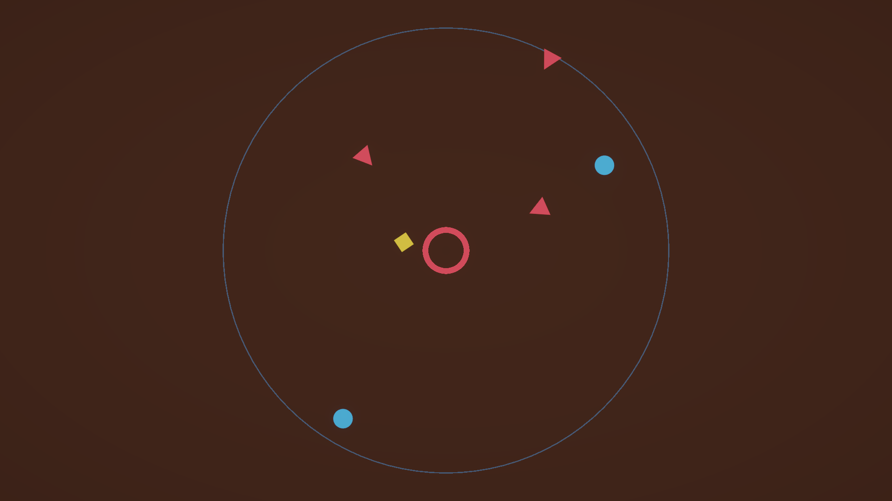

# 코드 펄스 개발일지 3

## ① 이번 목표
Unity에서 직접 계산하던 반주를 FMOD로 옮기는 것이 목표였다. 디펜스를 하면 곡이 연주되고 편곡도 바뀌는 느낌을 주도록 음악, 적 등장, 화면 연출이 모두 FMOD의 박자를 따르게 하려고 했다.

## ② 한 것

*지금 울리는 코드에 맞춰 배경 색이 바뀐다 (C 파랑 · Am 보라 · F 청록 · G 호박).*

반주를 FMOD Studio 이벤트 하나로 옮겼다. 게임은 FMOD가 알려 주는 박을 따라 진행된다. 처치 화음이 울리면 반주의 화음 악기 볼륨이 잠깐 낮아져 처치음이 묻히지 않는다. 피버에 들어가기 직전 한 마디 동안 스네어 롤과 상승 아르페지오가 나오고, 피버 첫 박에는 킥·클랩·오픈 햇이 함께 울린다. 피버 마지막 마디에서는 하강 아르페지오로 피버를 마무리한다. 108·116·124·132 BPM 네 구간은 4마디마다 무작위로 바뀌며, 가끔 느리고 적이 적은 "숨 돌리기" 구간도 나온다. 화면은 킥에 맞춰 경계 링이 커지고, 코드가 바뀌면 배경 색이 바뀌고, 피버 직전 한 마디 동안은 아레나가 줄어든다.

## ③ AI에게 보낸 부탁
Unity에 박자를 따로 적어 두지 말고, FMOD가 알려 주는 박만 믿고 적과 연출이 움직이게 해 줘. 다음 4마디에 어느 구간을 틀지는 Unity가 먼저 정해서 FMOD에 알려 주고, 그 정보로 적 등장과 연출을 미리 준비하게 해 줘.

## ④ 막힌 것과 고친 방법
처음에는 Unity가 코드에 적힌 BPM과 재생 시간으로 지금 몇 번째 박인지 계산했다. 그래서 구간이 무작위로 넘어가면 언제 넘어갔는지 알 수 없었다. FMOD에서 박이 지날 때마다 알림을 받아 Unity가 직접 박을 세도록 바꿨다. 그런데 구간을 건너뛰는 순간 같은 박 알림이 두 번 오거나 하나가 빠지는 일이 생겼다. 그래서 FMOD가 함께 보내는 "마디 안에서 몇 번째 박인지"를 기준으로 박 수를 바로잡게 했다. 75초 동안 구간을 6번 건너뛰는 테스트에서도 4마디 단위의 시작 박이 어긋나지 않았다.

## ⑤ 배운 것
랜덤 음악도 "무엇을 틀지는 Unity가 미리 정하고, 실제로 트는 건 FMOD가 마디 경계에 맞춰 하는" 방식으로 나누면 게임이 미래를 알 수 있다는 걸 배웠다. FMOD 안에서 무작위로 고르면 소리는 자연스럽지만 다음에 무엇이 나올지 Unity가 몰라서, 적이 다음 구간의 박에 맞춰 출발하게 만들 수 없다.

## ⑥ 다음 할 일
다음 편에서는 기본 반주 위에 트럼펫 같은 특색 루프가 가끔 끼어들고, 그때마다 화면에 무언가 날아다니는 전용 연출을 붙여 보려고 한다.
