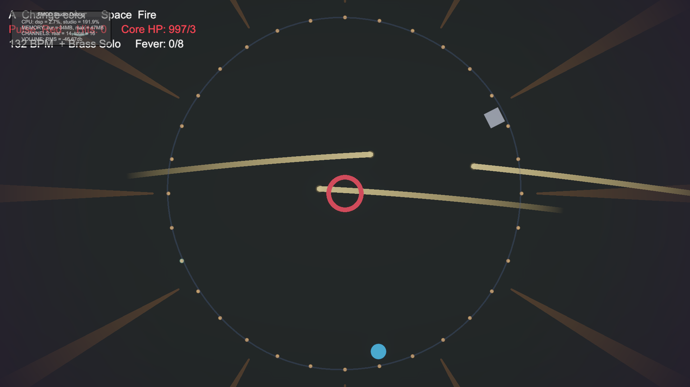

# 코드 펄스 개발일지 4

## ① 이번 목표
같은 반주가 계속 반복되지 않게 하는 것이 목표였다. 기본 반주 위에 트럼펫 같은 특별한 악기 루프(게스트 루프)가 가끔 끼어들게 하고, 반주 자체도 게임 상황에 따라 바뀌게 하려고 했다. 소리가 바뀔 때마다 화면 연출도 함께 바뀌게 하는 것까지 이번 범위로 잡았다.

## ② 한 것

*라틴 스타일 반주 위로 Brass Solo 게스트 루프가 끼어든 장면. 트럼펫 음마다 금색 혜성이 화면을 가로지르고, 배경에는 라틴 스타일의 햇살 무늬와 구슬 링이 깔린다.*

CC0 샘플(VSCO 2 CE 트럼펫·플루트·말렛, 라틴 타악기, 신스, 파워 코드)로 게스트 루프 12개를 만들었다. 게스트 루프는 네 프레이즈(4마디 단위)에 한 번꼴로 끼어들고, 악기마다 화면 연출이 따로 있다. 트럼펫은 혜성, 휘파람(플루트 고음을 깎아 만든 소리)은 새, 말렛(마림바·실로폰 같은 건반 타악기)은 별, 타악기는 링을 도는 점, 신스는 가장자리 파동, 기타는 충격파로 나온다. 루프가 시작되기 1박 전에는 화면 가장자리가 반짝여 등장을 예고한다.

반주는 네 가지 방향으로 바뀐다.
- **스타일:** 신스팝·라틴·펑크·드리미 사이를 오가며, 경계 링 모양과 배경 무늬도 스타일에 맞게 바뀐다.
- **위기감:** 적이 코어에 가까워지면 현악 패드와 애시드 베이스가 들어오고, 화면 가장자리가 어두워진다.
- **콤보:** 연속으로 처치하면 처치 화음에 7음과 벨 소리가 더해진다.
- **패턴 변형:** 프레이즈마다 드럼과 베이스 패턴이 조금씩 달라진다.

처치 화음도 지금 스타일의 악기로 울린다. 라틴에서는 마림바·비브라폰, 펑크에서는 브라스·기타로 소리가 난다. 피버 동안에는 킥마다 무지개 혜성이 양쪽에서 날아간다.

## ③ AI에게 보낸 부탁
기본 반주 위에 트럼펫 같은 게스트 루프가 가끔 끼어들게 하고, 음표 하나하나에 맞춰 화면에 무언가 날아다니게 해 줘. 루프를 고치면 FMOD 소리와 화면 연출이 같이 바뀌도록, 음표 데이터를 한 곳에서 만들어 줘.

## ④ 막힌 것과 고친 방법
4마디짜리 게스트 루프가 나오는 도중에 피버가 걸리면 소리와 연출이 중간에 끊겼다. 피버가 끝난 뒤에는 예고도 없이 루프의 뒷부분만 튀어나오기도 했다. 그래서 피버가 프레이즈 하나(4마디)를 통째로 차지하게 하고, 빌드업은 그 앞 프레이즈의 4마디째에 오게 했다. 게스트 루프가 4마디째까지 연주되는 중이면 피버를 한 프레이즈 미룬다. 다음 프레이즈에 미리 뽑아 둔 루프는 피버가 정해지면 취소한다. 이제 게스트 루프와 피버가 겹치지 않고, 피버가 끝나자마자 예고 반짝임과 함께 다음 루프가 들어온다.

## ⑤ 배운 것
음표 데이터를 한 곳에서 만들어야 소리와 연출이 어긋나지 않는다는 걸 배웠다. 처음에는 루프 목록이 Python 스크립트와 C# 코드에 따로 적혀 있었다. 그래서 루프를 12개로 늘렸는데도 게임은 6개만 골랐다. 이제는 Python 스크립트 하나가 FMOD에 넣을 음표와 Unity가 읽을 음표 표를 함께 만든다.

## ⑥ 다음 할 일
다음 편에서는 FMOD 로딩 지연 경고를 고치고, 직접 플레이하면서 게스트 루프·처치 화음의 음량과 연출 양을 다듬고, 화면이 너무 산만하지 않은지 확인해 보려고 한다.
