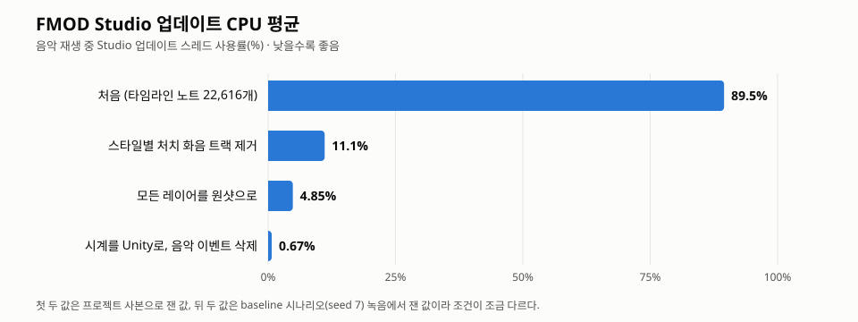

# 코드 펄스 개발일지 5

## ① 이번 목표
게스트 루프와 적응형 배경을 넣은 뒤로 음악이 가끔 끊기고, Unity 콘솔에 FMOD 경고(`Loading delay exceeded`)가 계속 찍혔다. 이번 목표는 원인을 숫자로 찾아 FMOD의 CPU 부하를 줄이는 것이었다. 앞으로 스타일이나 악기를 더 늘려도 무거워지지 않는 구조로 바꾸는 것까지 목표로 잡았다.

## ② 한 것

*작업 단계별 FMOD Studio 업데이트 CPU 평균. 마지막 단계(시계를 Unity로 옮김)는 다음 편 내용이다.*

**1. 부하가 어디서 나오는지 쟀다.** FMOD의 `getCPUUsage`로 재 보니, 소리를 섞는 DSP는 1% 남짓인데 Studio 업데이트 스레드가 100~150%였다. 음악 이벤트 하나의 타임라인에 노트 22,616개가 깔려 있었고, 박마다 파라미터 조건으로 켜고 끄는 구조였다. 이 노트들을 매번 다시 따지느라 제때 처리하지 못해 소리가 늦게 나고 있었다.

**2. 범인을 골라냈다.** 프로젝트 사본을 만들고 Unity 코드는 그대로 둔 채 뱅크만 바꿔 가며 비교했다.

| 뱅크 | Studio 업데이트 평균 / 최대 | 경고 |
|---|---|---|
| 그대로 (노트 22,616개) | 89.5% / 147.5% | 30번 |
| 스타일별 처치 화음 트랙 5개 제거 (노트 10,368개 감소) | **11.1% / 40.9%** | **0번** |
| 트랙은 두고 노트별 엔벨로프만 제거 | 93.9% / 158.3% | 14번 |

무거운 건 소리의 종류가 아니라 **노트 개수**였다. 스타일별 처치 화음 트랙을 빼자 뱅크도 12.5MB에서 5.5MB로 줄었다.

**3. 구조를 바꿨다.** 노트를 타임라인에 미리 다 깔아 두면, 스타일·색·보이싱 같은 축을 하나 늘릴 때마다 노트 수가 곱으로 불어난다. 그래서 FMOD에는 "마림바 도", "킥 한 방" 같은 낱개 음 이벤트(원샷)만 두고, Unity가 박 시각을 계산해 필요한 음만 예약해서 울리게 바꿨다.
- 처치 화음부터 원샷으로 옮겼다. 짝수/홀수 박 파라미터나 1.45박 길이 제한 같은 우회 장치가 필요 없어졌고, 빼 두었던 스타일별 처치 음색도 다시 살릴 수 있게 됐다.
- 이어서 배경 레이어, 드럼, 게스트 루프, 피버 레이어까지 차례로 원샷으로 옮기고 타임라인 노트를 지웠다. 뱅크는 7.07MB에서 2.75MB로 줄었다.
- 레이어를 하나 옮길 때마다 같은 시나리오로 게임 소리를 녹음해, 음량과 타이밍이 예전과 같은지 비교했다.

| 측정 (baseline 시나리오) | 처음 | 처치 화음 트랙 제거 후 | 모든 레이어 원샷 후 |
|---|---|---|---|
| Studio 업데이트 CPU 평균 | 89.5% | 약 11% | 4.85% |
| 소리를 섞는 Core DSP 평균 | 약 1% | 1.5% | 1.79% (예산 6% 이내) |

**4. 연출 쪽 렉도 따로 쟀다.** Unity 프로파일러로 재 보니 연출 스크립트 전체는 평균 0.5ms로 작았다. 끊김을 만드는 건 게스트 루프가 처음 나올 때 오브젝트를 새로 만드는 순간과, 라인 좌표를 매 프레임 다시 쓰는 부분이었다. 그래서 연출 오브젝트를 게임 시작 때 미리 만들어 두고, 라인은 처음 한 번만 그린 뒤 크기·회전만 바꾸게 했다.

## ③ AI에게 보낸 부탁

이번에는 한 번에 부탁하지 않고, 측정 결과를 보면서 여러 번 나눠 물었다.

1. 경고 로그를 붙여 넣으며 원인부터 물었다.
   > fmod studio가 종종 crash 되던데, 이 원인도 파악해줘

   > fmod가 너무 무거웠던걸까?
2. 숫자가 나온 뒤 구조를 바꾸자고 했다.
   > fmod를 최적화할 계획을 세워야 할것 같아. 22,600 notes on one timeline, and it takes minutes to save라는데, 구조를 새로운 방식으로 짜야할것 같거든

   > 스타일이나 악기 같은 축을 더 늘려 가려면 지금 구조로는 안 되겠다는 거였어. 그리고 현재 새 루프 로딩시 한번씩 fmod 로딩이 안되거나 (경고 로그) 같은 오류들이 발생하거든
3. AI가 세 가지 방법을 내놨다.
   - A: 레이어를 오디오 루프로 미리 녹음하고, 처치 화음만 원샷으로 옮긴다.
   - B: 모든 음을 Unity가 원샷으로 예약한다.
   - C: 이벤트만 쪼갠다.

   처음엔 A를 추천했지만, "원샷 이벤트가 뭐야?"라고 되묻자 B의 박 정확도에 대한 설명이 틀렸다고 스스로 정정했다. 웹 빌드 범위를 정해 주고 B를 골랐다.
   > 원샷 이벤트는 어떤 이벤트를 정의한거야?

   > 웹빌드는 일단 지금까지의 샘플링으로만 간다고 생각하고, 이후에는 웹 빌드를 생각하지 않는다고 하면 B가 조금더 나은 선택지 같아

   > 일단은 화음은 하나로 고정시켰어. 이쪽에 CPU 부하의 원인인것 같아서. 하지만 여전히 지금도 연출등 때문에 웹으로는 부하가 심한것 같아
4. 설계 문서를 승인하고 실행 방식을 정했다.
   > 승인, 계획 작성

   > 서브에이전트 방식
5. 연출 렉은 다른 채팅에서 따로 부탁했다.
   > 연출이 렉을 좀 유발하는게 있어서 최적화 작업을 해야할것 같아

## ④ 막힌 것과 고친 방법
처치 화음 노트 1만 개를 까는 큰 스크립트를 FMOD 커맨드라인 도구로 돌리면, 저장 직후에 도구가 크래시했다. 프로젝트 파일은 멀쩡했지만 같은 명령에 이어 붙여 둔 뱅크 빌드가 실행되지 않았다. 그래서 Unity는 8시간 전 뱅크로 소리를 내고 있었고, 고친 게 반영이 안 돼 한참 헤맸다. 이제는 큰 스크립트를 돌린 뒤 뱅크 빌드를 따로 실행하고, 뱅크 파일 시각이 바뀌었는지 확인한다.

원샷으로 옮긴 뒤에는 처치 화음이 불협화음으로 들렸다. 음 높이를 고르는 `Note` 파라미터를 정수 단위(이산형)로 만들어서, 60번 음을 고르면 59번 음까지 같이 울리고 있었다. 연속형 파라미터로 바꾸고, 188개 음을 하나씩 따로 렌더링해 옆 음이 같이 울리지 않는지 확인했다. 10초가 넘는 샘플은 FMOD가 스트리밍으로 읽어 0.3~1.2초 늦게 시작한다는 것도 이때 알게 돼, 원샷이 쓰는 샘플은 스트리밍을 껐다.

## ⑤ 배운 것
느리다고 짐작으로 고치지 말고, 먼저 어디가 느린지 재야 한다는 걸 배웠다. FMOD가 무거운 이유는 소리를 섞는 일(DSP)이 아니라, 타임라인에 깔린 노트 수만큼 조건을 다시 따지는 Studio 업데이트였다. 구조를 고를 때는 축을 하나 늘릴 때 비용이 곱으로 느는지 합으로 느는지를 먼저 보게 됐다.

## ⑥ 다음 할 일
다음 편에서는 구간이 바뀌는 순간 소리와 화면이 잠깐 멈추는 문제를 고치기 위해, 박을 세는 시계를 FMOD에서 Unity로 옮긴 과정을 정리하려고 한다.
