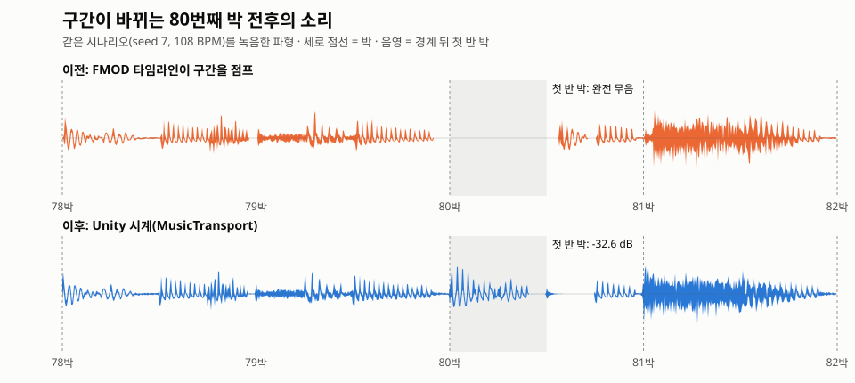

# 코드 펄스 개발일지 6

## ① 이번 목표
CPU 부하는 줄었지만, 구간이 바뀔 때마다 소리와 박이 순간적으로 멈추는 끊김이 여전히 남아 있었다. 화면 연출도 박을 따라 움직이기 때문에 같이 굳어서, 게임 전체가 멈춘 것처럼 보였다. 이번 목표는 박을 세는 시계를 FMOD 타임라인에서 Unity로 옮겨 이 끊김을 구조적으로 없애는 것이었다.

## ② 한 것

*같은 시나리오를 녹음한 파형. 예전에는 FMOD 타임라인이 구간을 점프하는 80번째 박 뒤 첫 반 박이 완전 무음이었다. Unity 시계로 바꾼 뒤에는 그 자리에도 소리가 그대로 이어진다.*

**1. 끊김이 어디서 생기는지 먼저 확인했다.** 게임 소리를 그대로 녹음하는 측정용 씬(`AudioCapture`)을 만들어, 구간이 바뀌는 경계마다 소리가 얼마나 늦고 얼마나 비는지 쟀다.

| 경계 | 템포 | 타임라인 점프 | 박 신호 지연 | 첫 반 박 |
|---|---|---|---|---|
| 32박 | 108→116 | 없음 | -2ms | 정상 |
| 48박 | 116→108 | 있음 | +350ms | 크게 약해짐 |
| 80박 | 108→108 | 있음 | +321ms | 완전 무음 |
| 96박 | 108→116 | 있음 | +823ms | 크게 약해짐 |

템포가 바뀌는 것 자체는 문제가 아니었다. 끊김은 FMOD 타임라인이 다른 구간으로 점프하는 경계에서만 생겼다. 그동안 100ms가 넘는 프레임은 한 번도 없었으니 Unity가 느린 것도 아니었다.

**2. 시계를 Unity로 옮겼다.** 예전에는 FMOD 타임라인이 악보이자 지휘자였다. 구간이 바뀔 때마다 악보의 다른 쪽으로 점프해야 했고, 그 순간 연주가 잠깐 멈췄다. 이제는 Unity의 `MusicTransport`가 지휘자다.
- `MusicTransport`는 FMOD 믹서의 DSP 클럭(오디오 샘플 번호) 위에서 박을 계산한다.
- 구간 경계는 "몇 번째 샘플"이라는 정수로 정해서, 템포가 여러 번 바뀌어도 오차가 쌓이지 않는다.
- 템포 전환은 점프가 아니라 "이 샘플부터 BPM이 바뀐다"는 계산이다.
- 모든 소리(배경, 드럼, 게스트 루프, 피버, 처치 화음)는 같은 시계로 "몇 번째 샘플에 울려라"라는 예약을 받는다.
- 마지막에는 FMOD의 음악 이벤트를 아예 지웠다. FMOD는 이제 낱개 음을 재생하고 섞고 덕킹을 거는 일만 한다.

**3. 화면 박도 같은 시계를 따르게 했다.** DSP 클럭은 믹서 블록 단위(약 21ms)로만 갱신되어 그대로 쓰면 계단처럼 움직인다. 그래서 블록 사이를 부드럽게 보간해 화면 연출용 박을 만들었다.

| | 전 | 후 |
|---|---|---|
| 구간이 바뀌는 순간의 소리 | 0.2~0.8초 끊김 | 측정한 모든 경계에서 지연 0ms |
| 그 순간의 화면 연출 | 박이 55~59ms 멈췄다가 뜀 | 멈춤 0ms, 뒤로 간 적 0회 |
| 소리가 박에 맞는 정도 | 평균 0.5ms 안팎 | 평균 0.02ms, 최대 0.04ms |
| 구간 전환 직후의 처치 화음 | 늦게 울리거나 빠짐 | 늦음 0, 빠짐 0 |
| FMOD Studio 업데이트 CPU (baseline) | 평균 약 9% | 평균 약 0.7% |
| 새 스타일이나 구간 추가 | FMOD 이벤트를 고치고 노트를 곱으로 깔아야 함 | 패턴 데이터와 악기만 추가 |

## ③ AI에게 보낸 부탁

1. 증상을 설명하며 근본적인 해결을 부탁했다.
   > 현재 전반적인 렉은 많이 해결했지만, (Docs\superpowers\plans\2026-11-25-fmod-scheduled-layers-stages-3-8.md 참고) 지금 여전히 fmod가 루프를 새로 꺼낼때마다 연출과 로딩 문제 때문인지 순간적인 렉으로 게임이 끊기는 느낌이 있어. 장기적인 프로젝트를 위해서는 근본적인 구조 개선과 이러한 것을 해결할 필요가 있을것 같은데. 단순히 CPU 개선만으로는 좀 부족한것 같아
2. AI는 원인이 CPU가 아니라 FMOD 타임라인의 구간 점프일 수 있다고 보고, 화면까지 멈추는지 아니면 소리만 멈추는지 물었다.
   > 일단은 소리-박자만 멈췄던것 같아. 연출이 fmod와 같이 연동되어서 연출이 멈춰서 화면도 멈춘것처럼 보이기도 하지만
3. AI가 세 가지 방법을 내놨다.
   - A: 시계를 Unity로 옮긴다.
   - B: 점프가 멈추는 원인을 찾아 고친다.
   - C: 연출 시계만 떼어 낸다.

   A를 고르기 전에 위험부터 물었다.
   > A를 했을때 예상되는 문제는 뭐야? 개인적으로 생각했을때 박과 fmod가 어긋나는 점이 생각나는데
4. AI는 시계가 하나가 되면 오히려 어긋날 여지가 줄어든다고 답했다. 대신 Unity가 길게 멈추면 그 사이 소리가 빠질 수 있다는 위험을 알려 줬다. 그리고 점프가 정말 원인인지 먼저 재 보자고 해서, 직접 돌려 보라고 했다.
   > 그럼 Unity에서 돌려봐줘
5. 측정으로 원인이 확인된 뒤 설계, 승인, 실행으로 진행했다.
   > A안으로 설계

   > 승인, 계획 작성

   > 서브에이전트로 실행
6. 작업이 끝난 뒤, 무엇이 바뀌었는지 알기 쉽게 정리해 달라고 했다.
   > 그럼 진행전에 변화전후 비교를 비전공자도 어느정도 이해할수 있게 정리해주겠어?

   > 그러면 기존 스튜디오 방식대신 직접 녹음해서 그 루프를 트는 방식인거지?

   답은 "아니다"였다. 녹음한 루프를 트는 게 아니라, 악보 데이터를 보고 낱개 음을 매번 새로 연주하는 자동 피아노에 가깝다.

## ④ 막힌 것과 고친 방법
예약한 원샷이 박보다 일찍 울리는 문제가 있었다. 특히 15fps처럼 프레임이 느릴 때 심했다. 원인은 순서였다. 인스턴스를 시작하면 다음 FMOD 업데이트에서 바로 소리가 나는데, "언제 울려라"라는 지연 값은 한두 프레임 뒤에야 걸렸다. 그래서 인스턴스를 멈춘 상태로 시작하고, 지연 값을 건 다음에 재개하도록 바꿨다. 이제 일찍 울리는 음은 0개이고, 모든 음이 예약 시각에서 ±0.6ms 안에 울린다. 시작 시각이 이미 지난 음은 늦게 울리지 않고 버린다.

Windows 빌드에서만 소리가 약 3dB 작고 군데군데 비는 문제도 이때 찾았다. 빌드 설정에서 동시에 낼 수 있는 소리가 32개로 막혀 있었다. 낱개 음을 많이 예약하는 구조로 바뀌면서 이 한도를 넘은 것이다. 256개로 올리자 에디터와 빌드의 차이가 0.001dB로 줄었다.

## ⑤ 배운 것
리듬 게임에서는 박을 정하는 시계가 하나여야 한다는 걸 배웠다. 예전에는 FMOD 타임라인이 드럼을 울리고, Unity는 그 박을 추정해서 다른 소리와 연출을 얹었다. 시계가 둘이라 한쪽이 멈추면 다른 쪽이 어긋났다. 또 하나, 고치기 전에 먼저 재 봐야 한다. "점프가 원인일 것"이라는 가설을 녹음으로 먼저 확인했기 때문에, 큰 구조 변경을 확신을 갖고 시작할 수 있었다.

## ⑥ 다음 할 일
다음 편에서는 아직 남은 수동 확인을 직접 해 보려고 한다. 창 포커스 이탈, 출력 장치 변경, 게임 오버 후 바로 재시작, 몇 분간의 실제 플레이에서 소리가 빠지지 않는지 볼 생각이다.
