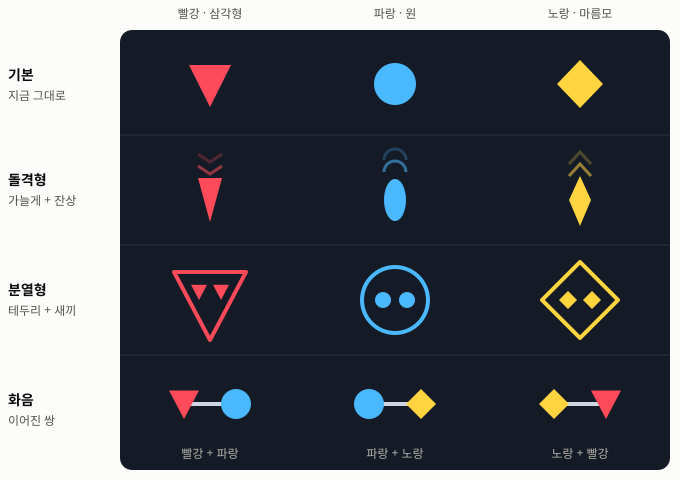
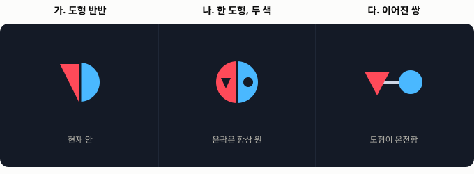
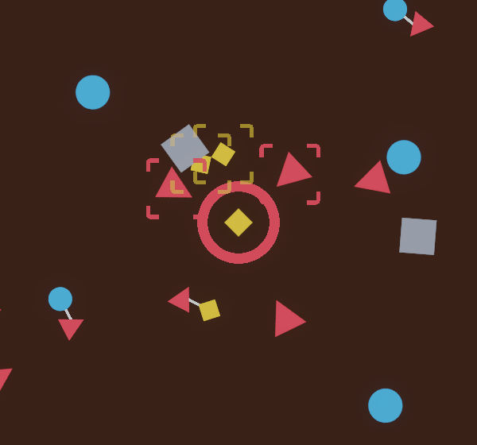
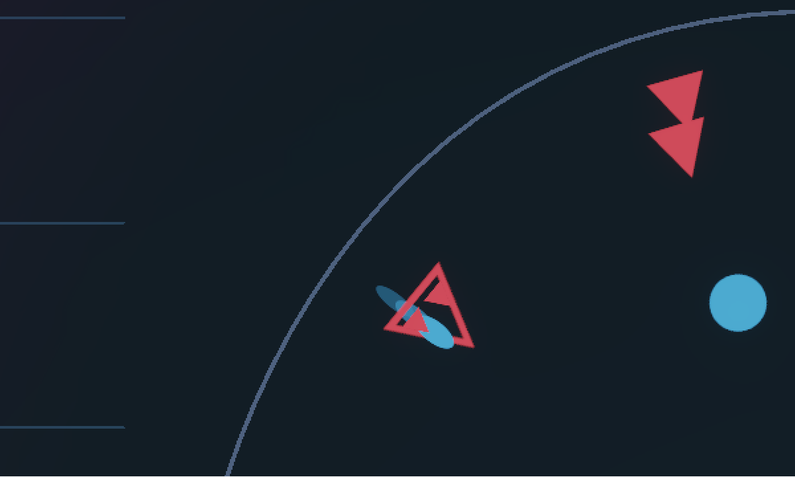

# 코드 펄스 개발일지 7

## ① 이번 목표
지금까지는 소리와 박자를 만드는 데 집중했다. 그런데 막상 해 보니 펄스 색을 가장 가까운 적에 맞추고 Space만 누르면 대부분의 적이 죽어서, 게임으로서의 재미가 없었다. 이번 목표는 게임다운 규칙을 넣는 것이었다. 쏠지 기다릴지 고민하게 만들고, 음악에 맞춰 몰려오는 많은 적을 읽고 모아서 한 번에 잡는 쾌감을 주려고 했다. 방향은 **"박치도 할 수 있는 리듬게임"**으로 잡았다. 박에 맞춰 누르는 정확도는 요구하지 않는다.

## ② 한 것

*기획 단계에서 잡은 적 모양 시안. 원칙은 "색은 도형이 말하고, 종류는 표식이 말한다"이다. 돌격형은 가늘게 늘리고 잔상을 붙였다. 분열형은 큰 테두리 안에 죽으면 나올 같은 색 새끼 둘을 보여 준다. 화음 적은 두 색의 도형을 막대로 이은 쌍이다. 처음 시안에서는 분열형 새끼가 다른 두 색이었고 화음 적은 도형을 반씩 붙인 모양이었는데, 논의를 거쳐 지금 모양으로 바꿨다.*

*도형을 반씩 붙인 화음 적은 대칭이 아니라 헷갈렸다. 그래서 대안 세 가지를 비교했고, 도형이 온전히 보이는 '다. 이어진 쌍'을 골랐다.*

아래는 실제 게임 화면이다.

*막대로 이어진 원+삼각형이 화음 적이고, 회색 사각형이 회색 적이다. 가장 가까운 적들에는 꺾쇠 조준 마커가 붙어 있다. 코어 안의 노란 마름모는 지금 고른 색을 도형으로 보여 준다.*

*가운데 속 빈 빨간 삼각형이 분열형이다. 안에 죽으면 나올 작은 새끼 둘이 보인다. 그 옆의 길쭉한 파란 도형이 잔상을 끌고 오는 돌격형이다.*

### 1. 펄스 규칙
- **쿨타임 1박:** 펄스를 쏘면 1박 동안 다시 쏠 수 없다. 초가 아니라 음악의 박으로 재서, 108~132 BPM에서 약 0.45~0.55초다. 처음엔 2박이었는데 플레이해 보고 1박으로 줄였다.
- **박치용 입력 예약:** 쿨타임이 끝나기 0.25박 전부터 누른 입력은 버리지 않고 기억했다가, 풀리는 순간 발사한다.
- **쿨타임 표시:** 코어 안쪽의 호가 쿨타임 동안 차오른다. 색 전환(A)은 쿨타임과 상관없이 언제나 된다.
- **피버 중에는 쿨타임이 없다.**

### 2. 점수와 콤보
- **다중 처치 점수:** 한 펄스의 n번째 처치는 n점이다. 4마리를 한 번에 잡으면 1+2+3+4 = 10점이다. 많이 모아서 한 번에 잡을수록 이득이다.
- **콤보:** 펄스가 적을 하나라도 잡으면 +1이다. 회색 적의 껍질만 벗긴 펄스는 그대로 유지된다. 아무것도 못 잡고 막히거나 끝까지 빗나가면, 또는 적이 코어에 닿으면 0이 된다. 콤보는 화면 오른쪽에 큰 숫자로 하나씩 올라가고, 0에서 30으로 커질수록 흰색에서 금색으로 바뀐다.
- **피버 게이지와 콤보 분리:** 피버는 화면에 안 보이는 피버 게이지가 10이 되면 다음 루프에 시작된다. 콤보는 피버 중에도, 피버가 끝난 뒤에도 계속 이어지는 별개의 보상이다. 피버가 끝나면 게이지만 0부터 다시 쌓인다.

### 3. 몰려오는 압박: 밀물과 썰물
- 기본 적의 속도를 0.65에서 0.4로 낮추고 수를 크게 늘렸다. 밀물 때는 화면에 10~20마리가 떠 있다.
- 음악이 쉬는 프레이즈(썰물)에는 드문드문 한 마리씩 온다. 고조되는 프레이즈(밀물)에는 템포가 빠를수록 촘촘하게 몰려온다.
- 같은 색이 3~7마리씩 뭉쳐 오고, 사이사이 다른 색이 끼어들어 어느 색부터 정리할지 고민하게 만든다.
- 적이 많아지자 음악 긴장도가 밀물 내내 최대치에 붙어 버렸다. 그래서 코어에 정말 가까운 무리만 세도록 긴장도 계산을 다시 맞췄다.

### 4. 적 종류
원칙은 **"색은 도형이 말하고, 종류는 표식이 말한다"**이다. 빨강은 삼각형, 파랑은 원, 노랑은 마름모다. 종류는 크기·테두리·잔상처럼 색이 아닌 표식으로 구분한다.

| 종류 | 모양 | 규칙 | 등장 |
|---|---|---|---|
| 기본 | 색별 도형 | 같은 색 펄스에 죽는다 | 처음부터 |
| 회색 | 회색 사각형 | 아무 색 펄스에 한 번 맞으면 본래 색이 드러나고, 그다음 일반 적처럼 죽는다 (체력 2칸) | 30초부터, 4번째 스폰마다 |
| 화음 | 서로 다른 색의 작은 도형 둘을 막대로 이은 쌍 | 순서 상관없이 두 색으로 한 번씩 맞혀야 죽는다. 마지막 처치 때 두 악기가 섞인 화음이 울린다 | 60초부터 |
| 돌격형 | 진행 방향으로 가늘게 늘어난 작은 도형, 뒤에 잔상 두 겹 | 기본 적의 2배 속도. 틀린 색 펄스에 맞으면 1.5배씩, 최대 2번 더 빨라진다 | 70초부터 |
| 분열형 | 1.5배 크기의 속 빈 테두리 안에 작은 도형 둘 | 죽으면 같은 색 새끼 둘로 갈라진다. 새끼는 부모를 죽인 그 펄스에는 맞지 않는다 | 80초부터 |

- 화음 적은 색 뭉치의 경계에 선다. 빨강 뭉치 뒤에 파랑 뭉치가 오면, 그 사이에 빨강+파랑 화음 적이 나온다. 색 순서를 읽으면 추가 펄스 없이 정리되고, 못 읽으면 한 발을 더 써야 한다.
- 화음 적의 반쪽이 터질 때는 파편만 튀고 소리는 나지 않는다. 소리는 마무리 순간에 두 악기가 함께 낸다.

### 5. 연출과 화면
- **조준 마커:** 가장 가까운 적의 네 모서리에 꺾쇠를 붙여 "다음 펄스가 처음 부딪힐 적"을 알려 준다. 꺾쇠는 박마다 살짝 조였다 풀리고, 적이 코어에 가까울수록 두꺼워지며 빨리 깜빡인다. 지금 고른 색이 이미 맞으면 약하게 보여 "준비됨"을 알린다. 피버 중에는 숨긴다.
- **피버 무지개:** 피버 동안 코어와 펄스가 무지개색으로 바뀌고, 펄스 한 방에 색과 상관없이 모든 적이 죽는다.
- **색약 대응:** 코어 안에 지금 고른 색의 도형(삼각형·원·마름모)을 표시한다. 이제 색을 못 봐도 모양만으로 플레이할 수 있다.
- **HUD 정리:** 왼쪽 위에는 체력과 BPM만 남기고, 체력은 하트 개수로 보여 준다. 점수는 오른쪽 콤보 숫자 아래에 있다.
- **시작 안내:** 게임이 시작될 때 작은 패널에 조작법(A: Change Pulse Color / Space: Shoot Pulse)을 보여 준다.

### 6. 구조
게임 규칙이 `ChordPulsePrototype.cs` 한 파일(740줄)에 모두 들어 있었다. 그래서 규칙을 Unity와 상관없는 작은 클래스로 떼어 냈다: 펄스 판정(`PulseResolver`), 쿨타임(`PulseCooldown`), 스폰(`SpawnDirector`), 긴장도(`TensionMeter`). 각 클래스에 EditMode 테스트를 붙였고, 마지막에는 전체 262개 테스트가 통과했다. 조정할 수치는 모두 `GameplayTuning.cs` 한 곳에 모았다.

## ③ AI에게 보낸 부탁

이번에는 두 채팅을 썼다. 하나는 게임 기능 구현, 하나는 게임 기획이다.

**게임 기능 채팅: 회색 적, 피버, 마커**
> 여기는 Chord-Pulse의 오디오 기능 외 게임 기능적인 부분을 담당하는 채팅이야

> 우선 회색적은 체력이 2칸으로, 아무 빔이나 맞으면 본래 색이 공개되는것으로 하고 싶어.

> 피버때는 코어가 여러색깔로(무지개색 느낌) 막 변했으면 좋겠어

> 피버 빔도 무지개색 느낌으로 해줘

> 피버 후에도 무지개색 원이 좀 남아있어

> 제일 가까운 적에게는 마커 같은게 달려있는게 좋을것 같은데 어떻게 하는게 좋을까?

AI가 세 가지 마커 안을 냈다: ① 적 주변 꺾쇠, ② 코어 링의 방향 표시, ③ 위험할수록 강해지는 마커. ①과 ③을 골랐다.
> 1+3번을 기본안으로 만들어줘

**게임 기능 채팅: 콤보와 HUD**
> 그리고 현재는 Fever가 적을 8번 처치하면 바로 되는데, 일단 Combo를 만들고 싶고, 적을 한번이라도 처치하면 Combo +1, 적을 처치하지 못하고 회색적을 때리면 Combo + 0, 아무 적도 처치하지 못하고 펄스가 끝에가서 없어지면 콤보 초기화 이런식으로 하고 싶어. 여기서 콤보가 10번 쌓이면 다음 루프에서 피버가 시작되는 식으로 하고 싶고, 피버가 끝난후 다시 10번 쌓아야하는 식으로 가고 싶어.

> 유니티 MCP 다시켰으니 컴파일 확인해주고, 이러한 콤보는 화면 오른쪽에 크게 하나씩 오르는 것으로 표현해줘

> 그리고 게임이 처음 시작할때 작은 패널을 띄워서 A: Change Pulse Color / Space: Shoot Pulse 식으로 간단한 설명을 보여주고 시작하게 하고 싶어. 그리고 콤보에 다음 피버가 얼마 남았다 이런건 안넣어도 돼서 /10은 불필요한것 같아

> 피버 기능을 재는것과 콤보 숫자는 별개로 생각해줘. 10combo가 쌓여야 콤보 진입을 하되, 진입을 하고, 피버 중에도 적을 처치하면 계속 오른다고 생각하면 될것 같아

> 왼쪽위의 여러 정보들중 Core HP와, BPM만 남겨주고, Core HP는 하트 개수로 표현해줄래?

**게임 기획 채팅: 재미를 더하는 규칙**
> 이 세션은 게임기능 기획이야. 현재는 단순히 펄스색을 바꾸면서 space를 누르면 적이 대부분 처치가 되어서. 게임적인 재미가 없어서 이에 대한 추가적인 기획을 해보려고해. 몇가지 아이디어를 제시해줘

AI는 재미가 없는 원인을 세 가지로 짚었다. 쏘는 데 비용이 없고, 펄스가 전방위이며, 적이 모두 같은 속도로 직진한다는 것이다. 그리고 아이디어 여섯 가지를 냈다: 박자 판정, 펄스 에너지, 끌어들이기 보상, 화음 적, 적 행동 다양화, 방향성 펄스.
> 1,3을 기본으로하고 4,5를 좀 추가하고 싶어. 몰려오는 적을 버티는 압박도 표현하고 싶은데. 일단 화음적은 보라색 대신 빨강/파랑 반반씩 보이게 하고 이를 처치하면 두 악기의 혼합 화음이 나오도록 하게 하고 싶네

AI가 추천한 박자 판정은 내가 직접 뺐다.
> A로 가되, 한가지 수정하자. 박자 판정은 없애도록 하자. 박치도 할수있는 리듬게임 같은 느낌을 만들어보려 했거든

> A,B 합친 방향이 맞아. 많은 적을 처치하는게 좋을것 같아. 그리고 현재 색이 3가지 있는데 색약한테도 괜찮을까?

AI가 분열형, 돌격형, 나선형을 제안했고, 분열형과 돌격형을 골랐다.
> 분열형과 돌격형이 좋을것 같아. 둘의 모양을 어떻게 잡을지 기획해야할것 같은데, 각자 색깔별 기본 도형 모양을 기반으로 만들어야 할것 같아

AI는 분열형의 새끼를 "자기 색을 뺀 나머지 두 색"으로 제안했다. 이걸 같은 색으로 바꾸고, 쿨타임도 넣었다.
> 분열형은 같은 색을 우선 소환하는걸로 해줄래? 그리고 화음적의 모양이 대칭적이지 않아서 조금 헷갈리는 느낌이 있는데, 일단 좀 고민해보자. 그리고 펄스에 쿨타임도 조금은 넣는게 좋을것 같아. 1초 정도?

> 다로 해주고, 2박으로 해줘, 돌격형은 잘못된 펄스를 맞으면 속도가 오르는것으로 해주고. 피버중에는 쿨타임 해제가 좋은것 같아. 새끼는 부모를 죽인 그 펄스에는 맞지 않습니다.라는 규칙을 넣어줘. 일단은 다른 색이 없는걸로 가자

> 게이지를 깎지 않습니다는 빼줘. 콤보는 별개의 보상 시스템 느낌이야

> B로 진행해주고 서브에이전트로 제작 진행해줘. 그리고 피버 기준은 펄스 한번에 1로 그대로 가줘. 틀린색에 막히더라도 적을 처치했으면 콤보가 오르는건 그대로지?

> 무적없이 지금 규칙으로 유지하고, 화음적, 분열형 같은 특수적은 한 1분후부터 나오도록 해줘.

1단계를 플레이해 본 뒤 수치를 조정하고 다음 단계로 넘어갔다.
> 쿨타임은 한박정도면 될것 같고, 적의 수는 조금 더 늘려도 될것 같아. 이후 2단계 계획으로 넘어가줘

> 괜찮은것 같아 쭉 진행해줘

작업은 세 단계로 나눴다. 1단계는 기본 규칙, 2단계는 화음 적, 3단계는 분열형과 돌격형이다. 단계마다 서브에이전트가 테스트를 먼저 쓰고 구현한 뒤, 다른 서브에이전트가 설계 문서와 맞는지 검토했다.

## ④ 막힌 것과 고친 방법
피버가 끝난 뒤에도 코어에 무지개색이 남아 있었다. 코어 색을 되돌릴 때 그라디언트의 첫 색과 마지막 색만 바꾸고 있었기 때문이다. 중간에 있던 무지개 색 6개가 그대로 남아 있었다. 링 색 전체를 단색 하나로 통째로 바꾸는 함수를 만들어, 라운드 시작·피버 종료·색 변경 세 곳에서 쓰게 했다.

콤보와 피버 조건을 한 숫자로 세다 보니 규칙이 꼬였다. 피버 중에 Space를 연타하면 펄스 대부분이 허공으로 나가서 콤보가 계속 끊겼고, 피버가 끝나면 콤보도 0이 되어 버렸다. 그래서 둘을 나눴다. 화면에 보이는 콤보는 피버와 상관없이 이어지고, 피버 중에 빈 펄스가 나가도 끊기지 않는다. 피버를 재는 게이지는 화면에 안 보이게 따로 센다.

## ⑤ 배운 것
AI가 추천하는 재미와 내가 원하는 재미는 다를 수 있다는 걸 배웠다. AI는 리듬게임이니 박자 판정을 가장 먼저 추천했지만, 나는 박치도 즐길 수 있는 게임을 원했다. 원하는 느낌을 먼저 말로 정해 두니, 이후 결정(입력 예약, 다중 처치 점수, 밀물과 썰물)이 모두 그 방향으로 맞춰졌다. 또 규칙을 작은 클래스로 떼어 테스트를 붙여 두니, 수치를 바꿔도 규칙이 깨지지 않았는지 바로 확인할 수 있었다.

## ⑥ 다음 할 일
다음 편에서는 설정 패널(볼륨 조절)과 크레딧 화면, 게임 오버 연출을 마무리하고, 새로 받은 칩튠·보컬 찹 샘플로 게스트 루프를 늘려 보려고 한다.
