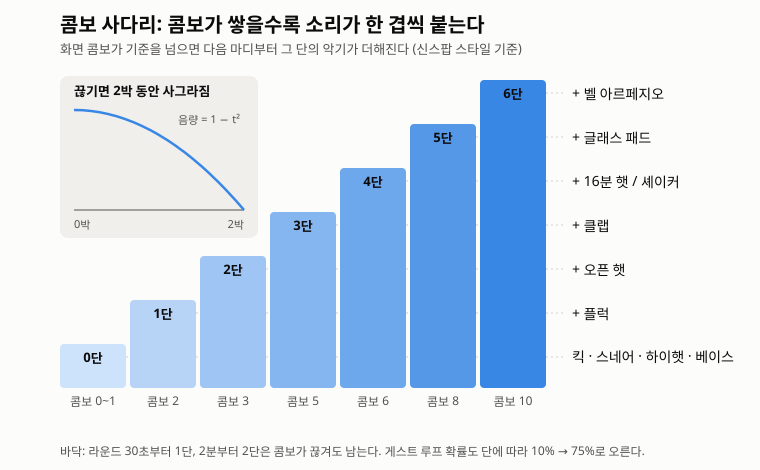

# 코드 펄스 개발일지 8

## ① 이번 목표
게임 규칙이 생기자 이번엔 음악이 단조롭게 느껴졌다. 코드 진행은 C–Am–F–G 하나뿐이었고, 모아 둔 샘플 중에도 안 쓰는 악기가 많았다. 이번 목표는 세 가지였다.
- 플레이할 때마다 매번 다른 음악이 나오게 한다.
- 새 게스트 루프마다 각자의 연출을 붙인다.
- 콤보를 쌓을수록 음악이 한 겹씩 두꺼워지고, 콤보가 끊기면 그 겹이 빠지게 한다.

## ② 한 것

*콤보 사다리. 화면 콤보가 기준을 넘을 때마다 다음 마디부터 악기가 하나씩 더해진다. 콤보가 끊기면 쌓인 겹이 2박에 걸쳐 사그라든다.*

### 1. 코드 진행 12종
프레이즈(4마디)마다 코드 진행을 하나씩 고른다. 모두 C장조 안의 코드(C Dm Em F G Am)라서 새 샘플 없이 어떤 파트든 옮길 수 있다.

| # | 이름 | 코드 | 분위기 |
|---|---|---|---|
| 0 | Classic | C Am F G | 밝음 (원래 진행) |
| 1 | Axis | C G Am F | 밝음 |
| 2 | Minor Axis | Am F C G | 어두움 |
| 3 | Royal Road | F G Em Am | 부드러움 |
| 4 | Turnaround | Dm G C Am | 밝음 |
| 5 | Plagal Lift | C F Am G | 밝음 |
| 6 | Melancholy | Am Em F G | 어두움 |
| 7 | Doo-wop | C Am Dm G | 밝음 |
| 8 | Sunrise | F C G Am | 부드러움 |
| 9 | Stepping Up | C Em F G | 부드러움 |
| 10 | Shadow | Am Dm G C | 어두움 |
| 11 | Pop Lament | Am F G Em | 어두움 |

- 진행은 한 프레이즈 앞서 고른다. 한 진행이 1~2 프레이즈 이어지고, 바뀔 때 바로 전 진행으로 돌아가지 않는다.
- 상황에 따라 고르는 진행이 달라진다. 피버에는 밝은 진행, 숨 돌리기에는 부드러운 진행이 나온다. 위기감이 높으면 어두운 진행이 3배 더 잘 나온다.
- 기존 파트는 자동으로 새 진행에 맞춘다.
  - 베이스는 코드마다 정해 둔 음역에서 다시 계산한다.
  - 화음 악기는 가장 가까운 보이싱으로 옮긴다.
  - 멜로디는 같은 음계 안에서 이동해 윤곽을 유지한다. 3음은 3음으로 가는 식이다.
- 처치 화음도 그 마디의 코드를 따라간다. Dm·Em 행을 추가했다.
- 결과: 패턴 조각이 80개에서 705개로, 음이 1,799개에서 18,200개로 늘었다. 12개 진행 모두 배경 음량이 -35.2 ~ -35.7 dB로 고르다.

### 2. 새 게스트 루프 15종
샘플을 모으는 채팅에서 반짝이는 소리, 특이한 소리, 칩튠, 보컬 찹을 더 찾았다. 모아만 두고 안 쓰던 악기들로 루프를 만들었다.

| ID | 이름 | 악기 |
|---|---|---|
| 19 | Sax Groove | 테너 색소폰 |
| 20 | Clarinet Swing | 클라리넷 |
| 21 | Flute Breeze | 플루트 |
| 22 | Horn Section | 호른 + 트롬본 |
| 23 | FM Piano Stabs | FM 피아노 |
| 24 | Chip Quest | 칩튠 리드 + 삼각파 베이스 |
| 25 | La La Choir | "라라" 보컬 |
| 26 | Tine Keys | 틴 피아노 |
| 27 | Mbira Ripple | 음비라 |
| 28 | Jingle Sparkle | 슬레이벨·탬버린·트라이앵글 |
| 29 | Toy Box | 장난감 타악기 |
| 30 | Acid Line | 애시드 베이스 |
| 31 | Twang Lick | 트왱 기타 |
| 32 | Fever Sax Blast | 피버용 색소폰 |
| 33 | Fever Chip Rush | 피버용 칩튠 |

- 음높이: 기음을 측정해 보니, 일부 샘플은 파일 이름보다 한 옥타브 높았다. 라라 보컬, 음비라, 클라리넷처럼 음이 조금씩 어긋난 샘플은 미세 튜닝으로 ±5센트 안에 맞췄다.
- 음량: 루프를 하나씩 렌더링해 기존 루프와 비슷한 -35.4 ~ -37.4 dB로 맞췄다.

### 3. 루프마다 다른 연출
루프는 33개로 늘었는데, 화면 연출은 악기 계열 6가지뿐이었다. 그래서 색소폰도 트럼펫처럼 혜성으로, 플루트도 휘파람처럼 새로 나왔다. 새 연출기 5종을 만들고 값만 바꿔 13가지 모양으로 썼다. 모두 아레나 바깥에만 그린다.

| 루프 | 연출 |
|---|---|
| Sax Groove | 보라색 연기가 흔들리며 피어오름 |
| Clarinet Swing | 나무색 마름모가 스윙 리듬으로 흔들리며 오름 |
| Flute Breeze | 연두색 바람결이 바깥으로 불려 감 |
| Horn Section | 아래 모서리에서 금빛 스포트라이트 |
| FM Piano Stabs | 음높이 자리에 흰 건반 막대가 켜짐 |
| Chip Quest | 8비트 픽셀이 16분마다 한 칸씩 걸어감 |
| La La Choir | 분홍빛 큰 빛 구슬이 천천히 떠오름 |
| Mbira Ripple | 옆 띠의 세로 현이 튕겨짐 |
| Jingle Sparkle | 눈송이 마름모가 돌며 떨어짐 |
| Toy Box | 파스텔 블록이 튀어 올랐다 떨어짐 |
| Acid Line | 위쪽 가장자리에 오실로스코프 파형 |

### 4. 콤보 사다리
레이어를 0단부터 6단까지 한 줄로 세웠다. 화면 콤보가 2 / 3 / 5 / 6 / 8 / 10을 넘을 때마다 다음 마디부터 한 단씩 올라간다.
- **끊기면 사그라든다:** 틀린 색, 헛친 펄스, 코어 피격으로 콤보가 끊기면 위에 쌓인 레이어가 2박에 걸쳐 `1 - t²` 곡선으로 줄어들다 빠진다. 그 레이어를 그리던 연출도 같은 곡선으로 함께 빠진다.
- **바닥:** 라운드 30초부터는 1단, 2분부터는 2단이 콤보가 끊겨도 남는다. 오래 버틴 판이 너무 앙상해지지 않게 하기 위해서다.
- **게스트 루프도 콤보 보상:** 게스트 루프가 나올 확률을 단에 따라 10%에서 75%까지 올렸다. 5단 이상에서는 두 프레이즈 연속으로도 나온다.
- **FMOD는 그대로:** 페이드는 예약된 원샷마다 음량만 바꿔서 처리했다. 매 프레임 음량을 바꿔도 시작 시각이 흔들리지 않는다는 것을 먼저 측정해서 확인했다(64개 중 64개 지연 0).

## ③ AI에게 보낸 부탁

**코드 진행과 새 루프**
> 그럼 이 프로그레션 방향으로 전부 진행하고, 사용하지 않던 악기들도 한번 루프를 만들어주겠어? 아주 다양한 루프와 코드 진행으로 플레이마다 매번 다른 느낌을 주고 싶은게 목표야

**샘플 수집**
> 추가할만한 악기들이 더 있을까?

> 반짝이는 소리, 특이한 소리, 칩튠, 보컬 찹 계열로 찾아주겠어? 근데 샘플 폴더는 분리는 못하는거야?

**루프별 연출**
> 이제 루프들이 다양하게 추가됐는데, 연출들은 다원화가 되어있지않아서 이에대한 기획이 필요해. 다양한 연출들에 대한 아이디어를 내보고 적용시켜볼래?

**콤보 사다리**
> 이제 콤보별로 루프 레이어를 쌓는 느낌을 만들고 싶은데, 콤보가 올라감에 따라 루프가 강화되면서 게스트 루프가 나오게 하려면 현재 구조로 가능할까?

AI는 레이어 쌓기는 지금 구조로 된다고 답했다. 다만 게스트 루프는 콤보와 상관없이 확률로만 나온다고 짚었다. 그리고 게스트 루프가 반드시 나와야 하는지, 자주 나오면 되는지를 물었다.
> 콤보가 끊기면 페이드 아웃으로 연출과 음악이 빠지는 느낌이 났으면 하는데

> 그리고 게스트 루프는 콤보가 높을수록 자주 나오면 되는거야

설계 중에 AI가 선택지로 물어본 것에는 짧게 답했다. 사다리를 어떤 콤보로 셀지, 단을 무엇으로 정할지(시간 바닥 + 콤보), 피버와의 순서 같은 것들이다.
> 화면 콤보와 같게

> C: 시간 바닥 + 콤보

> 피버 전에 닿게

> 서브에이전트로

## ④ 막힌 것과 고친 방법
코드 진행을 넣자 Unity 에디터가 멈추고 블루스크린까지 떴다. 원인은 자동 생성한 악보 파일 `PatternTable.g.cs`였다. 음 18,200개를 배열 초기화식 하나로 만들어서, 정적 생성자 한 메서드에 전부 들어가 있었다. Unity의 Mono가 이 메서드를 컴파일하지 못해 스택 오버플로가 났다. 생성기를 고쳐 배열을 256개씩 나눈 여러 메서드로 채우게 했다. 데이터는 해시로 비교해 이전과 똑같은지 확인했다.

콤보 사다리를 만들 때는 끊긴 뒤 "이미 예약된 음"이 문제였다. 페이드를 걸어도 반 박 앞서 예약해 둔 윗단 음이 그대로 울릴 수 있었다. 그래서 끊기는 순간 바닥 위에 속한 음은 이미 울리는 음, 예약된 음, 페이드 중 새로 예약되는 음 모두 같은 곡선으로 줄이게 했다. 측정해 보니 곡선보다 약 0.08박 늦게 줄어드는데, 믹서 블록 하나만큼의 지연이라 그대로 두었다.

## ⑤ 배운 것
다양함은 재료를 늘리는 것보다 조합을 늘릴 때 커진다는 걸 배웠다. 진행 12개 × 스타일 4개 × 게스트 루프 33개 × 콤보 단 7개가 서로 곱해져서, 같은 판이 거의 나오지 않는다. 그런데도 패턴 데이터를 한 곳(Python 생성기)에서 만들기 때문에, 악기를 하나 더해도 연출과 처치 화음까지 같이 따라온다.

## ⑥ 다음 할 일
다음 편에서는 적이 나오는 곡선과 펄스의 손맛(판정, 피격, 콤보 예외, MISS)을 다듬은 과정을 정리하려고 한다.
