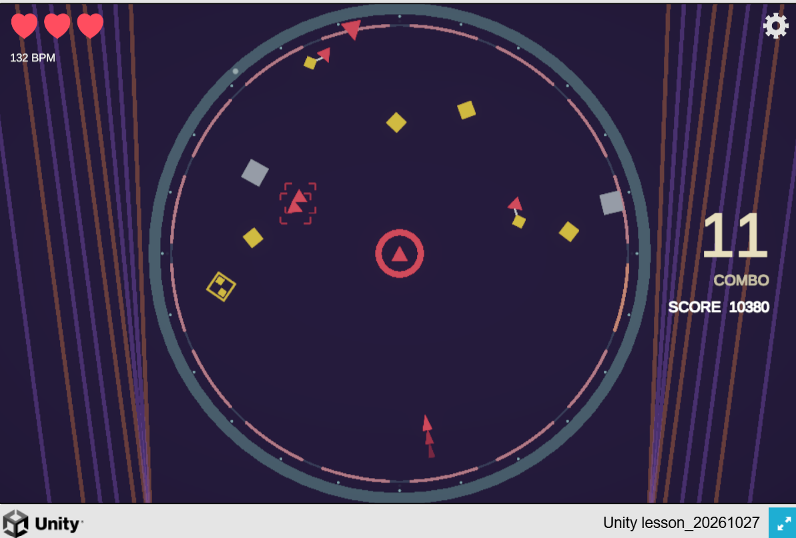
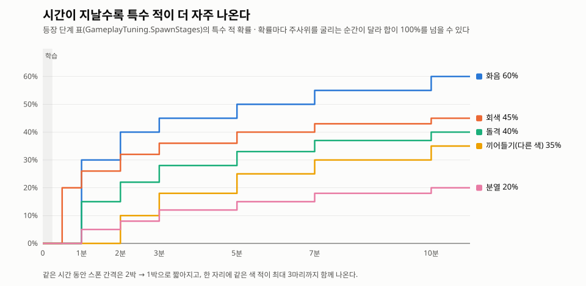

# 코드 펄스 개발일지 9

## ① 이번 목표
특수 적과 콤보가 들어갔지만, 판의 흐름은 아직 엉성했다.
- 처음 하는 사람에게는 시작이 너무 갑작스러웠다.
- 80초가 지나면 난이도가 더 오르지 않았다.
- 판정을 너그럽게 바꾼 뒤로는 내가 1만 점을 쉽게 찍을 만큼 쉬워졌다.
- 펄스를 쏠 때의 손맛에도 억울한 순간이 있었다. 표시된 적의 색을 쐈는데 안 죽는다든지, 회색 적을 맞혔는데 콤보가 깨진다든지 하는 순간이다.

이번 목표는 한 판의 곡선을 짜고, 펄스와 피격의 손맛을 다듬는 것이었다.

## ② 한 것

*웹 빌드에서 플레이한 화면. 왼쪽 위에 하트 체력과 BPM, 오른쪽에 콤보와 점수가 있다. 막대로 이은 화음 적, 회색 사각형, 속 빈 분열형, 잔상을 끄는 돌격형이 함께 몰려온다.*

### 1. 적 등장 곡선
목표는 "처음 하는 사람은 15초 안에 규칙을 익히고, 조금 익숙한 사람은 약 3분, 잘하는 사람은 10분까지" 버티는 것이었다. 세 방식(단계 표, 공식 하나, 실력 반응형)을 비교해 **단계 표**를 골랐다. 시간대마다 한 줄씩 값을 적어 두고, 조정할 때 줄 하나만 고치면 된다.

| 시작 | 스폰 간격 | 2마리 | 3마리 | 회색 | 화음 | 돌격 | 분열 | 다른 색 끼어들기 |
|---|---|---|---|---|---|---|---|---|
| 0초 | 2박 | – | – | – | – | – | – | – |
| 15초 | 1.5박 | – | – | – | – | – | – | – |
| 30초 | 1박 | 15% | – | 20% | – | – | – | – |
| 1분 | 1박 | 30% | – | 26% | 30% | 15% | 5% | – |
| 2분 | 1박 | 40% | 10% | 32% | 40% | 22% | 8% | 10% |
| 3분 | 1박 | 45% | 20% | 36% | 45% | 28% | 12% | 18% |
| 5분 | 1박 | 45% | 30% | 40% | 50% | 33% | 15% | 25% |
| 7분 | 1박 | 40% | 40% | 43% | 55% | 37% | 18% | 30% |
| 10분 | 1박 | 35% | 50% | 45% | 60% | 40% | 20% | 35% |

- **0~15초는 학습 구간**이다. 2박마다 한 마리씩만 나온다.
- **같은 색 뭉치:** 한 자리에 같은 색 적이 최대 3마리까지 같이 나온다. 같은 속도로 나란히 와서 펄스 하나로 함께 잡힌다. 적 풀은 96마리로 늘렸다.
- **한 무리는 체력 1:** 한 자리에서 나온 무리가 함께 코어에 닿아도 체력은 1만 깎인다. 화음 적은 무리 없이 혼자 나오고, 무리 안의 적들은 조금씩 벌어져서 온다.
- **2분부터 색이 섞인다:** 뭉치 안의 자리 하나가 다른 색으로 끼어들 수 있다. 한 자리(한 박) 안에서는 여전히 같은 색이다. 판정을 바꾼 뒤 너무 쉬워져서 넣은 규칙이다. 회색 적 비율도 줄마다 5~10%p 올렸다.
- 확률의 합이 100%를 넘는 이유: 종류마다 주사위를 굴리는 순간이 다르다. 화음은 새 뭉치가 시작될 때, 회색·분열은 자리마다, 돌격은 뭉치가 끝날 때 굴린다. 그래서 10분 줄에서도 실제로는 적 다섯 중 하나 정도가 특수 적이다.

### 2. 조준 마커와 판정을 똑같이
"꺾쇠가 붙은 적의 색으로 쐈는데 안 죽는" 일이 있었다. 원인은 두 가지였다.
- 마커는 거리 차이 0.06 이내를 "같은 거리"로 보고, 펄스 판정은 0.01 이내만 동시에 맞은 걸로 봤다. 기준이 서로 달랐다.
- 삼각형은 판정 원보다 작게 그려져서, 눈에는 멀어 보여도 실제로는 같은 거리일 수 있었다.

판정과 마커가 같은 함수(`PulseResolver.ContactRadius`)와 같은 기준을 쓰게 했다. 이제 꺾쇠가 붙은 적의 색으로 쏘면 그 적은 반드시 죽는다.

여기에 **펄스 관통 여유**를 더했다. 펄스가 다른 색 적에 막히거나, 회색을 드러내거나, 화음 적을 한 겹 벗겨도 바로 사라지지 않는다. 적 하나 크기만큼 흐려지며 더 나아가다 사라지고, 그 사이에 있는 같은 색 적은 잡는다.

### 3. 코어 피격
- 맞으면 1.5초 동안 무적이 되고, 그동안 코어가 깜빡인다.
- 화면이 0.4초 동안 크게 흔들리고, 화면의 적이 모두 파편으로 부서진다. 이때는 점수·콤보·처치음이 나오지 않는다. 몰려오던 무리에 연속으로 맞아 순식간에 끝나는 일을 막기 위해서다.
- 마지막 체력이 깎일 때는 적을 지우지 않고 바로 게임 오버 연출로 넘어간다.

### 4. 콤보 예외 처리
회색 적이나 화음 적은 다른 색 적과 같은 거리에서 함께 나온다. 그래서 회색을 드러낸 펄스가 옆의 다른 색 적에도 닿으면 "다른 색에 막힌 펄스"로 처리돼 콤보가 깨졌다. 펄스가 무엇을 진행시켰는지 따로 기록해 규칙을 이렇게 정리했다.

| 처치 없는 펄스 | 콤보 |
|---|---|
| 회색을 드러냄 (다른 색 적에 같이 맞아도) | 유지 |
| 화음 적을 한 겹 벗김 (다른 색 적에 같이 맞아도) | 유지 |
| 다른 색 적에만 맞음 | 초기화 |
| 화음 적을 두 색 어느 쪽도 아닌 색으로 맞힘 | 초기화 |
| 아무것도 못 맞히고 끝까지 감 | 초기화 |

### 5. 코어와 MISS 연출
- **깨지는 코어:** 체력이 줄 때마다 코어 링에 금이 가고 이가 빠진다. 피버 중에도 그대로 보인다.
- **피버 회전:** 피버 중에는 무지개 링이 한 마디에 한 바퀴씩 돈다. 금과 틈도 같이 돈다. 피버는 4마디라 정확히 4바퀴를 돌고 제자리에서 끝난다.
- **박자 번쩍임:** 박마다 코어가 흰색으로 잠깐 번쩍인다. 킥 박은 세게, 나머지 박은 60% 세기로 번쩍여서 마디의 흐름이 느껴진다.
- **MISS:** 콤보가 깨지면 그 자리에 "MISS"가 튀어 올랐다 사라진다. 다른 색 적에 막혔으면 그 적 위에, 아무것도 못 맞혔으면 코어 위에 뜬다. 콤보가 0일 때도 항상 띄운다.

## ③ AI에게 보낸 부탁

**등장 곡선**
> 그러면 세가지를 설계부터 잡아주고, 초기 15초정도는 아예 모르는 사람이 익숙해질수 있게 적이 조금씩 나오는 방향으로 설계해서 점점 많아지도록 해줘. 그리고 후반으로 갈수록 적 수가 올라가고 특수적(회색, 화음, 돌격, 분열)이 나오는 확률이 올라가도록 해주고

> 같은 색을 한꺼번에 여러 마리 보내는 식(펄스 하나로 같이 잡히는 뭉치)으로 풀어줘. 풀 크기는 우선 96까지로 올려두자. 그리고 한 판은 조금 익숙한 사람은 3분정도 할 수 있도록 하고 싶어. 잘하는 사람은 10분까지도

> 한번에는 많아야 3마리 까지면 충분할 것 같아. A로 그대로 가도 될것 같은데, 물어볼것은 적의 등장확률이 다 합쳐서 100%가 넘는경우는 어떤 경우인거야?

> 적 규칙을 조금 더 수정해야할것 같아. 2~3분 이후부터는 다른 색끼리 섞여 나올수도 있게 하려고해. 지금 내가 1만점을 쉽게 찍은것을 보면 판정 변경이후로 게임이 좀 많이 쉬워졌어. 다른 색끼리 섞여나올때는 한박에는 같은 색으로 나오되, 한 뭉텅이에서는 서로 다른 색이 나올수도 있는거로 하려고 해. 그리고 회색적의 빈도도 지금 보다 조금 더 올려야 할것 같고

> 끼어들기로 진행

**마커와 판정, 피격**
> 이 다음에 현재 꺽쇠로 포커스하는 기능에 대해서 좀 더 이야기하려고해. 이 것의 의도는 제일 가까운거를 포커스해서 색깔을 맞추기 쉽게하기 위함이었는데, 가끔 같은 거리에 있거나 모양에 따라서 조금 가까워지면서 포커스 색을 쏴도 적이 안죽는 경우가 있어. 이에 따라 펄스가 바로 막히지는 않고 조금은 더 가다 없어지는 방향성을 생각하고 있기도 했고, 아니면 다른 방식으로 제일 가까운 물체를 표현하는게 어떨까 싶어

AI는 원인 두 가지를 짚었다. 그리고 "1단계: 마커를 판정과 맞추기"를 먼저 하고, "A: 펄스 관통 여유"나 "B: 펄스 예고 링" 중 하나를 더하자고 제안했다.
> 1 + A로 해줘. 그리고 코어 피격시 무적도 넣어야할거 같은데. 이때 피격시 전체 화면이 흔들리면서 적들도 한번 지워지는게 좋을것 같아.

**콤보 예외**
> 콤보에 대한 예외처리를 몇가지 해야할것 같아. 화음적을 때린 상태로 아무도 죽지 않으면 콤보가 깨지고, 회색적 + 다른색 적을 맞췄을때 콤보가 깨지는것 같은데 로직을 확인해보고 이 경우들은 콤보가 유지(늘어나진 않음)되는 것으로 해줄래?

**코어와 MISS 연출**
> 코어가 체력에 따라서 점점 깨지는 느낌이 났으면 좋겠는데, 피버때도 그렇게 보이도록 하고. 가능해?

> 그리고 현재 깨진 상태에서 피버상태일때 그라데이션만 회전하는데, 이를 원 자체가 회전하도록 해주고(금과 틈도 같이). 박자에 따라 가운데 코어도 흰색으로 잠시 번쩍거려서 박자를 느낄수 있도록 해주겠어

> 그리고 이제 Combo가 깨질때 Miss문구도 넣으려고해. 만일 다른색 적에 닿아서 Combo가 깨지면 그 적 위치에 Miss가 펄스가 아무도 안맞은거면 코어에 Miss가 뜨도록 해줘

> 항상 띄우기

## ④ 막힌 것과 고친 방법
마커 문제를 처음엔 "판정이 이상하다"고 생각했다. 그런데 코드를 보니 판정은 맞았고, 마커가 판정과 다른 기준으로 "같은 거리"를 재고 있었다. 화면에 보이는 정보와 실제 규칙이 다른 숫자를 쓰면, 플레이어에게는 그게 곧 버그다. 두 쪽이 같은 함수를 부르게 바꿔서, 앞으로 한쪽만 고쳐지는 일이 없게 했다.

관통 여유를 넣자 이번엔 콤보가 더 자주 깨졌다. 펄스가 더 멀리 가면서 같은 묶음의 다른 색 적에 닿는 일이 늘었기 때문이다. 한 가지를 너그럽게 바꾸면 다른 규칙이 그 영향을 받는다. 그래서 "막혔는가"만 보던 콤보 판정에 "무엇을 진행시켰는가"를 더해 ②-4의 표로 정리했다.

## ⑤ 배운 것
난이도는 마리 수보다 **색이 바뀌는 빈도**가 정한다는 걸 배웠다. 같은 색은 펄스 하나로 몇 마리든 잡히니, 적을 많이 보내도 같은 색이면 쉽다. 반대로 한 뭉치 안에 다른 색이 한 자리만 끼어들어도 확 어려워진다. 그리고 수치를 한 표에 모아 두니, "1만 점이 너무 쉽다" 같은 느낌을 줄 하나만 고쳐서 바로 반영할 수 있었다.

## ⑥ 다음 할 일
다음 편에서는 설정·크레딧·게임 오버·결과 화면 같은 게임 바깥 화면과, 그 과정에서 잡은 버그들을 정리하려고 한다.
