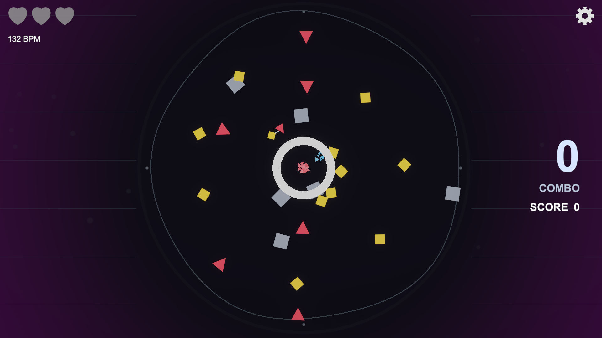
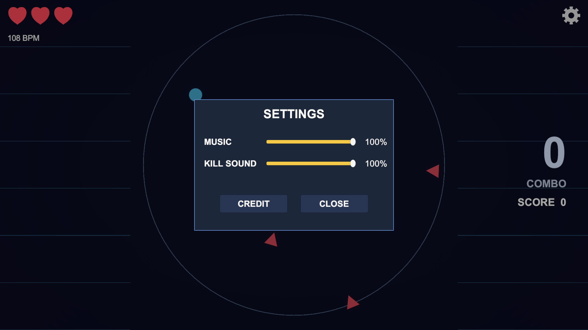
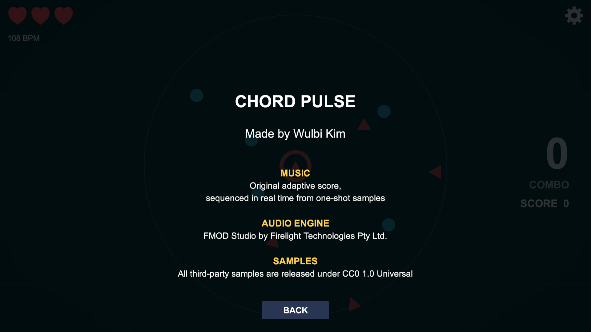

# 코드 펄스 개발일지 10

## ① 이번 목표
게임 안의 규칙과 음악은 어느 정도 모양을 갖췄지만, 게임 바깥의 화면은 비어 있었다. 볼륨을 바꿀 곳도, 출처를 밝힐 곳도 없었고, 게임 오버는 Restart 버튼이 갑자기 뜨는 게 전부였다. 이번 목표는 설정·크레딧·게임 오버·결과 화면을 만들어 한 판의 시작과 끝을 다듬는 것이었다. 그 과정에서 나온 버그들도 함께 잡았다.

## ② 한 것

*게임 오버 연출의 1.4초 지점. 흔들림 구간이 끝나 경계 링이 일그러져 있고, 코어가 터지며 흰 충격파가 막 퍼지기 시작한다. 왼쪽 위 하트는 모두 비어 있다.*

*톱니바퀴를 누르면 열리는 설정 패널. 열려 있는 동안 게임과 음악이 함께 멈춘다.*

*Credit 버튼을 누르면 흐르는 크레딧. 뒤의 게임 화면은 어둡게 가라앉는다.*

### 1. 설정 패널
- 화면 오른쪽 위의 톱니바퀴 버튼을 누르면 설정 패널이 열린다. 기존 UI 패널 체계(`UIManager`)에 새 프리팹으로 등록했다.
- 음악(MUSIC)과 처치음(KILL SOUND) 볼륨을 각각 조절한다. 값은 저장되어 다음 실행에도 유지된다.
- **패널을 열면 음악까지 완전히 멈춘다.** 게임만 멈추고 음악이 계속 흐르면 박자가 어긋나기 때문이다.
  - FMOD 마스터 채널 그룹을 일시정지하는 방식이다. 모든 소리가 이 그룹의 시계를 기준으로 예약되므로, 닫으면 멈춘 그 박자에서 그대로 이어진다.
  - 측정해 보니 패널을 연 10초 동안 박이 8.422에서 움직이지 않았고, 닫은 뒤 화면 박(23.407)과 시계 기준 계산값(23.398)이 맞았다.

### 2. 크레딧
- 설정 패널의 Credit 버튼을 누르면 "Made by Wulbi Kim"과 게임에 쓴 음악·샘플의 출처가 영화 엔딩 크레딧처럼 아래에서 위로 흐른다.
- 출처는 지어내지 않고, 저장소에 기록된 출처 파일(`SOURCES_AND_LICENSES.txt`, `sample-manifest.json`)에서만 가져왔다.
- 이후 새로 추가된 악기도 크레딧에 넣었다. 직접 합성한 소리는 크레딧에서 뺐다. 출처를 몰랐던 측정용 클릭 두 개도 직접 합성한 것으로 확인돼, 출처 기록 파일에 따로 적었다.

### 3. 게임 오버 연출
마지막 체력이 깎이면 바로 Restart가 뜨지 않고, 맵 전체가 흔들리다 터지는 2.5초짜리 연출이 먼저 나온다.

| 구간 | 시간 | 연출 |
|---|---|---|
| 멈춤 | 0~0.1초 | 화면이 멈추며(히트 스톱) 흰색으로 번쩍이고, 코어가 하얗게 질린다 |
| 흔들림 | 0.1~1.1초 | 슬로모션(약 35%) 속에 적, 펄스, 코어, 경계 링이 점점 세게 떨린다. 비네트가 안쪽으로 조여 온다 |
| 충격파 | 1.1~1.9초 | 코어가 터지고 충격파가 퍼진다. 닿는 순서대로 적은 자기 색 파편으로 터지고, 경계 링은 24조각으로 갈라져 날아간다 |
| 정리 | 1.9~2.5초 | 파편이 사라지고 화면이 어두워진 뒤 결과 창이 뜬다 |

- 음악은 로우패스로 먹먹해지면서 약 2.3초에 걸쳐 사라진다.
- 마지막에 연타하던 키가 잘못 눌리지 않도록, 게임 오버 후 0.5초 동안은 입력을 무시한다. 그 뒤에는 Space·Enter·클릭으로 연출을 건너뛸 수 있다.

### 4. 결과 창과 HUD
- 결과 창에 그 판의 **최고 콤보(MAX COMBO)**와 **점수(SCORE)**가 나온다. 재시작하면 초기화된다.
- HUD의 하트를 글자 대신 이미지로 그리게 바꿨다. 웹 빌드에서 하트 글자가 보이지 않았기 때문이다.

### 5. 정리
- 템플릿 프로젝트에서 남은 것들을 지웠다: 샘플 씬, 튜토리얼 안내, 떨어지는 블록 프로토타입 스크립트와 프리팹, 크래시 복구 씬.
- 아무도 부르지 않는 함수와 멤버도 함께 지웠다. 지우기 전에 GUID로 검색해서 다른 씬이나 프리팹이 참조하지 않는지 확인했다.

## ③ AI에게 보낸 부탁

**설정 패널과 크레딧**: 이번에는 부탁을 한 문장으로 끝내지 않고, 확인할 것과 하지 말 것까지 적은 작업 지시서로 보냈다.
> Chord Pulse에 설정 패널과 크레딧 화면을 만들어 주세요.
> 1. 게임 화면 오른쪽 위에 톱니바퀴 모양 버튼을 둔다. 누르면 설정 패널이 열린다.
> 2. SettingPanel을 새 프리팹으로 만들고 기존 UIManager 패널 체계에 등록한다. 기존 패널(GamePanel, GameOverPanel, HelpPanel)의 등록 방식을 먼저 확인한다.
> 3. 설정 패널에서 볼륨을 조절한다. SoundManager의 MusicMix, KillChordMix(0~1)를 슬라이더에 연결하는 것이 출발점이다. 값을 다음 실행에도 유지할지 정하고 알려 준다.
> 4. 설정 패널에 Credit 버튼을 넣는다. 누르면 "Made by Wulbi Kim"과 게임에 쓰인 음악·샘플의 출처가 나열된다. 길면 영화 엔딩 크레딧처럼 흐르는 연출로 만들어도 된다.
> 5. 설정 패널이 열린 동안 게임과 음악이 어떻게 되는지 확인한다. 게임만 멈추고 음악이 계속 흐르면 박자와 어긋날 수 있으니, 문제가 보이면 선택지를 제시한다.
>
> 출처 목록은 지어내지 말고 저장소에 기록된 것만 쓴다. 기록이 없거나 빠진 것이 있으면 추측하지 말고 알려 준다.
>
> 주의: 요청하기 전에는 커밋하지 말고, 기존 변경은 그대로 둔다. 톱니바퀴 버튼이 HUD와 겹치지 않게 한다. 설정 버튼 클릭이나 패널 안의 키 입력이 게임 입력으로 새지 않는지 확인한다. FMOD 뱅크는 다시 빌드하지 않는다. 플레이 모드를 바꾸기 전에 상태를 확인하고, 내가 플레이 중이면 먼저 물어본다.

> 음악까지 완전 정지로 해줘

> 새로 추가된 루프나 샘플 중에 크레딧 화면에 추가안된게 있으면 추가해줄래?

> 직접 합성한거는 빼도 될것 같아. 칼림바는 수정해줄래?

**게임 오버와 결과 창**
> 게임 오버시 Restart가 바로 뜨기보단 맵의 모든 오브젝트들이 흔들리면서 터지는 연출 이후에 Restart가 나오게 하고 싶은데 한번 계획을 세우고 나에게 물어볼래?

> 구현 진행

> 그리고 마지막 결과 창에 가장 높은 콤보와 점수가 나오도록 해주겠어?

**버그 신고**
> 이후에도 웹빌드를 계속 올렸는데, 이번에는 하트가 나오지 않고, 가운데의 코어와 적모양의 위치가 일치하지 않아. 한번 체크해줄래?

> 위치 변경이 게임오버 연출을 완전히 보고 난후 restart를 누르면 발생하는것 같아. 이후에도 계속 변경돼

> 적 킬소리가 아예 없어졌는데 무슨 문제야?

> 지금 확인해줄래? 플레이중 다른 창으로 이동했다가 다시 플레이하니 킬 소리가 없어졌어

**정리**
> 죽은 코드들과 중복되는 기능들을 리뷰해주고 정리해줄래

## ④ 막힌 것과 고친 방법
**웹 빌드에서 코어가 어긋남.** 처음에는 재현이 안 돼서 넘어갔다. 나중에 "게임 오버 연출을 끝까지 본 뒤 Restart를 누르면" 생긴다는 걸 직접 찾았다. 게임 오버 연출이 코어를 최대 0.16만큼 흔들어 놓고, 끝난 뒤 원래 자리로 돌려놓지 않았던 것이다. 그래서 판을 거듭할수록 어긋남이 쌓였다. 연출이 끝날 때와 Restart 때 코어 위치를 정확히 가운데로 되돌리게 했다. 게임 오버 → Restart를 세 번 연속 자동으로 돌려, 매번 (0, 0, 0)으로 돌아오는 걸 확인했다.

**다른 창에 다녀오면 처치음이 사라짐.** 사실 처치음이 사라진 게 아니라, 다른 창에 있던 시간만큼 늦게 나고 있었다. 게임 창이 포커스를 잃으면 FMOD는 소리 출력을 멈추지만, 모든 음의 시작 시각을 정하는 믹서 시계는 계속 흘렀다. 음악은 통째로 밀려서 티가 안 났지만, 처치음은 한참 뒤에 나서 사라진 것처럼 들렸다. 25초를 비웠더니 대기 중인 음이 35개에서 320개까지 쌓였다. 포커스를 잃으면 설정 패널을 열 때처럼 믹서 시계도 함께 멈추게 했다. 이후 대기 중인 음은 평소처럼 30~50개였고, 늦어서 버려진 음은 21개에서 0개가 됐다.

이 버그는 6편에서 시계를 Unity로 옮길 때 생긴 것이다. 그때도 "포커스 3초 이탈"은 확인했지만, 밀림이 3초뿐이라 드러나지 않았다. 짧게 시험하면 보이지 않는 버그도 있다.

**FMOD의 `mixerSuspend`는 시계를 멈추지 않았다.** 설정 패널을 만들 때 처음엔 믹서를 일시정지하는 함수를 쓰려 했다. 그런데 실측해 보니 Windows에서는 이 함수를 불러도 시계가 계속 갔다. 그래서 마스터 채널 그룹을 직접 일시정지하는 방식으로 바꿨다.

## ⑤ 배운 것
AI에게 부탁할 때 "무엇을 만들지"만큼 "무엇을 확인하고, 무엇을 하지 말지"를 적는 게 중요하다는 걸 배웠다. 설정 패널 지시서에 "출처는 지어내지 말 것", "음악이 계속 흐르면 박자가 어긋나니 확인할 것"을 미리 적어 두었다. 덕분에 크레딧에 없는 출처가 들어가지 않았고, 패널이 열린 동안 음악을 멈춰야 한다는 문제도 만들기 전에 드러났다.

## ⑥ 다음 할 일
다음 편에서는 설정 패널의 실제 키 입력(Esc로 닫기, 닫는 순간의 Space·A 누수)과 웹 빌드 동작을 직접 확인하고, 몇 분간 실제로 플레이하며 3분·10분 난이도 곡선을 맞춰 보려고 한다.
